<div align="center">

# CampusCare

**A tap-and-go digital health-center workflow, built around the NFC chip already inside your college ID card.**

[](#project-status)
[](#license)
[](#technology-stack)
[](#technology-stack)
[](#technology-stack)
[](#technology-stack)
[](#nfc-architecture)

</div>

---

## Overview

CampusCare replaces the campus health center's paper-and-token workflow with one connected, role-based system — from NFC check-in through doctor-specific queues, structured consultation, prescriptions, and dispensing, to a permanent visit history.

It's a Software Engineering course project (UCS503P, 5th semester), built by a four-person team. Most of the system is a conventional health-center management application. The part worth pointing at is the entry point:

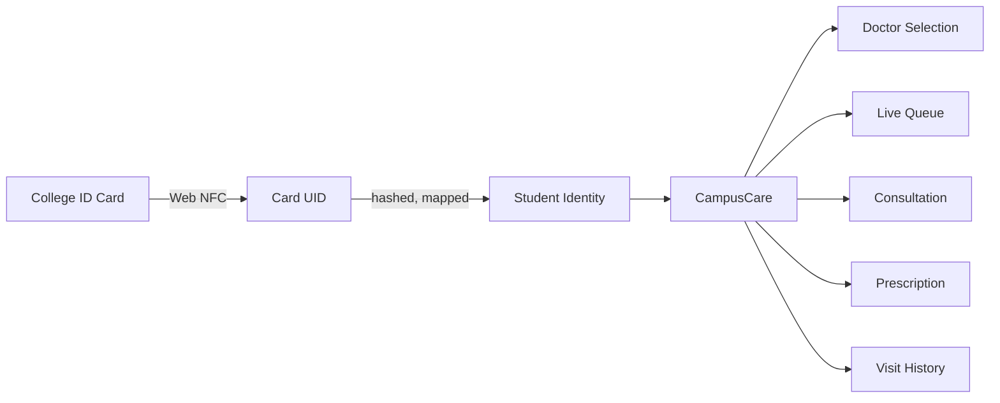

No new card is issued. No dedicated reader is bought. The existing college ID — already used for gate and library access — becomes the physical key into the digital workflow. The team's own ID card has already been tested against Android Chrome via Web NFC over HTTPS, and its UID reads successfully — a confirmed capability, not an assumption.

---

## Table of Contents

- [Project Status](#project-status)
- [Problem](#problem)
- [Solution](#solution)
- [Core Workflow](#core-workflow)
- [User Roles](#user-roles)
- [Architecture](#architecture)
- [NFC Architecture](#nfc-architecture)
- [Authentication & Authorization](#authentication--authorization)
- [Medical Record Model](#medical-record-model)
- [Prescription Model](#prescription-model)
- [Queue Model](#queue-model)
- [Emergency Workflow](#emergency-workflow)
- [Database](#database)
- [Testing Philosophy](#testing-philosophy)
- [Security Principles](#security-principles)
- [Project Scope](#project-scope)
- [Repository Structure](#repository-structure)
- [Development Workflow](#development-workflow)
- [Technology Stack](#technology-stack)
- [Getting Started](#getting-started)
- [Environment Variables](#environment-variables)
- [Deployment](#deployment)
- [Development Roadmap](#development-roadmap)
- [Definition of Done](#definition-of-done)
- [Engineering Principles](#engineering-principles)
- [Team](#team)
- [License](#license)

---

## Project Status

| Component | Progress | Notes |
|---|:---:|---|
| Requirements |  | |
| Architecture & ERD |  | |
| Database |  | |
| Backend |  | |
| Frontend |  | |
| Authentication |  | |
| Queue System |  | |
| Prescription |  | |
| RFID / NFC |  | Feasibility test complete — real card, real UID read |
| Testing |  | |
| Deployment |  | |

Percentages are approximate and updated as implementation progresses.

---

## Problem

A workflow built on paper records and physical queues breaks down at real scale. CampusCare targets four concrete failure points:

<details>
<summary><b>Unclear queues</b></summary>
<br>

Students have no reliable way to know who's ahead of them, when they'll be called, whether the doctor is available, or which doctor they're even waiting for.
</details>

<details>
<summary><b>No accessible longitudinal record</b></summary>
<br>

A consultation begins with no convenient access to a student's previous visits, conditions, allergies, or prescriptions.
</details>

<details>
<summary><b>Handwritten prescriptions</b></summary>
<br>

Hard to read, easy to lose, and impossible to structure for reminders or future analytics.
</details>

<details>
<summary><b>No separation between routine care and emergencies</b></summary>
<br>

Routine consultations and trauma cases have fundamentally different operational needs — CampusCare keeps the emergency log entirely separate from the normal doctor queue.
</details>

---

## Solution

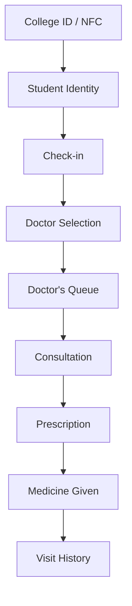

---

## Core Workflow

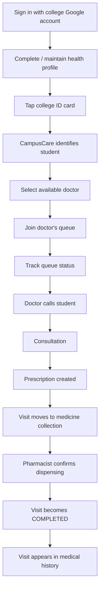

---

## User Roles

<table>
<tr><th>Role</th><th>Can</th><th>Cannot</th></tr>
<tr>
<td><b>Student</b></td>
<td>Authenticate via college Google account · maintain health profile · NFC or staff-assisted check-in · select an available doctor · view own queue status, history, and prescriptions</td>
<td>Change their own role · access other students' records · create prescriptions · modify completed clinical records</td>
</tr>
<tr>
<td><b>Doctor</b></td>
<td>View own queue · call next student · view patient history and health profile · record consultations · create structured prescriptions · redirect to the other doctor · mark consultation complete</td>
<td>—</td>
</tr>
<tr>
<td><b>Pharmacist / Receptionist</b></td>
<td>Staff-assisted manual check-in · confirm medicine dispensing · log substitutions/deviations · log emergency/trauma cases · view records per access policy</td>
<td>—</td>
</tr>
<tr>
<td><b>Administrator</b></td>
<td>Manage doctor and pharmacist/receptionist accounts · mark doctor availability · enroll and revoke RFID credentials · view system-level logs</td>
<td>—</td>
</tr>
</table>

---

## Architecture

CampusCare follows a conventional three-tier architecture, kept deliberately boring on purpose — the interesting engineering is in the workflow, not the topology.

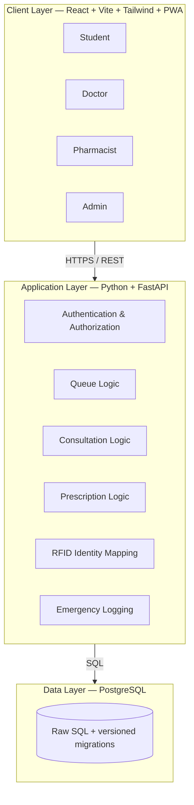

---

## NFC Architecture

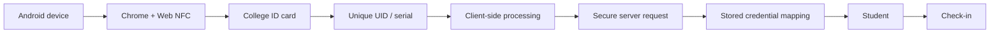

> **Important:** CampusCare never treats the raw UID as identity. The system maintains a controlled mapping — `RFID credential → student → CampusCare account` — and the UID is **hashed before storage**, not kept in the clear.

---

## Authentication & Authorization

Students authenticate via the college Google identity flow. Staff accounts are role-controlled. The backend is the single source of truth for permissions — the frontend hiding a button is never treated as authorization.

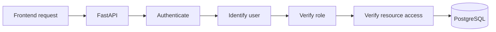

Every protected endpoint performs server-side authorization, independent of anything the client claims.

---

## Medical Record Model

**Health Profile** — longer-lived: allergies, known conditions, blood group, current medications, emergency contact.

**Visit History** — per completed visit: doctor, consultation notes, prescription, dispensing record, timestamps, redirection info where applicable.

Splitting these lets a doctor see longitudinal context instead of treating every consultation as an isolated event.

---

## Prescription Model

No free-text prescription box. Every item is structured:

| Field | Example |
|---|---|
| Medicine | Example Medicine |
| Strength | 500 mg |
| Form | Tablet |
| Route | Oral |
| Morning / Afternoon / Night | 1 / 0 / 1 |
| Duration | 5 days |
| Food instruction | After food |
| PRN | — |
| Additional instructions | — |

Exact fields will be locked down with the finalized requirements before implementation.

---

## Queue Model

Each doctor holds an independent queue:

```
Doctor A                  Doctor B
─────────                 ─────────
Student 01                Student 02
Student 04                Student 05
Student 09                Student 07
```

Queue position is *derived* from ordering/state, never stored as a fixed number.

**No-show handling**

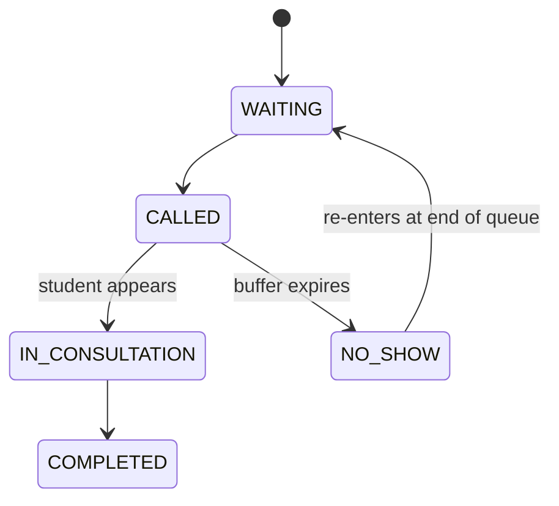

**Doctor redirection** — if a student joined the wrong queue, the doctor moves them to the correct one. It stays the same clinical encounter; the system changes routing rather than silently spawning a second, unrelated visit.

---

## Emergency Workflow

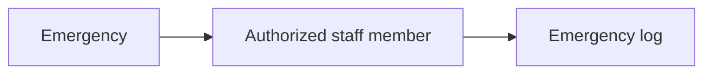

No normal doctor queue. No student queue position. No doctor-selection screen. This mirrors how the dispensary actually operates — trauma cases aren't routed through routine consultation infrastructure.

---

## Database

PostgreSQL, deliberately without an ORM:

- Raw SQL
- Foreign keys, constraints, indexes
- Transactions
- Version-controlled migrations

**Conceptual entities:** Users · Students · Staff · Doctors · RFID Credentials · Health Profiles · Visits · Queue Entries · Consultations · Prescriptions · Prescription Items · Dispensing Records · Emergency Cases · Audit Logs

---

## Testing Philosophy

A feature isn't done because it works — it's done because its **failure paths** are handled too:

- Unknown or revoked card?
- Student already checked in?
- Doctor unavailable?
- Student doesn't show?
- Two requests arrive simultaneously?
- Session expires mid-flow?
- Network fails?

---

## Security Principles

`Server-side authorization` · `Least-privilege role access` · `Secure authentication` · `Hashed RFID identifiers` · `HTTPS everywhere in deployment` · `Secrets outside source control` · `Database constraints` · `Transaction-safe queue operations` · `Audit logging` · `Synthetic data in dev/demo — no real medical records outside authorized environments`

---

## Project Scope

<table>
<tr><td valign="top" width="34%">

**Core — Semester Deliverable**

- Google-based student auth
- Health profile
- NFC / RFID check-in
- Staff-assisted manual check-in
- Doctor selection & availability
- Doctor-specific queues
- No-show handling
- Doctor redirection
- Consultation records
- Structured prescriptions
- Pharmacist dispensing
- Emergency log
- Role-based access
- Admin panel
- Audit logging
- Deployment & testing

</td><td valign="top" width="33%">

**Stretch Goals**

*Only after core is stable*

- Medication reminders
- Seasonal disease-surge analytics

</td><td valign="top" width="33%">

**Explicitly Out of Scope**

*This semester*

- Medicine inventory management
- AI diagnosis
- Symptom-based auto-triage
- Automated medical decisions
- Payment processing
- Insurance integration
- Native Android app
- Hospital/ambulance integration

</td></tr>
</table>

Scope discipline is intentional — a smaller system that works beats a larger one that doesn't.

---

## Repository Structure

```
campuscare/
├── frontend/
│   ├── src/
│   ├── public/
│   └── package.json
│
├── backend/
│   ├── app/
│   │   ├── routes/
│   │   ├── services/
│   │   ├── repositories/
│   │   ├── schemas/
│   │   └── auth/
│   ├── tests/
│   └── requirements.txt
│
├── database/
│   ├── migrations/
│   └── seed/
│
├── docs/
│   ├── requirements.md
│   ├── use-cases.md
│   ├── permissions.md
│   ├── architecture.md
│   └── decisions.md
│
├── .gitignore
└── README.md
```

---

## Development Workflow

```
main
 └── develop
      ├── feature/student-auth
      ├── feature/queue-system
      ├── feature/rfid-checkin
      └── feature/prescription
```

- No direct pushes to `main`
- One feature → one branch → one pull request
- At least one teammate reviews every change
- Tests pass before merge
- Keep commits focused
- Never commit secrets or real medical records

---

## Technology Stack

| Layer | Technology |
|---|---|
| Frontend | React |
| Build Tool | Vite |
| Styling | Tailwind CSS |
| App Model | Progressive Web App |
| Backend | Python |
| API Framework | FastAPI |
| Database | PostgreSQL (raw SQL) |
| Authentication | Google Identity + application session |
| RFID / NFC | Web NFC |
| Real-time (v1) | Polling |
| Real-time (v2) | WebSockets |
| Frontend Hosting | Vercel / Netlify |
| Backend Hosting | Render (or similar) |
| Database Hosting | Managed PostgreSQL |
| Version Control | Git + GitHub |

---

## Getting Started

### Prerequisites

`Git` · `Node.js LTS` · `Python 3.11+` · `PostgreSQL` · an IDE

Recommended: Postman/Bruno/Insomnia, pgAdmin/DBeaver, an Android device with NFC for Web NFC testing.

### Clone

```bash
git clone <repository-url>
cd campuscare
```

### Frontend

```bash
cd frontend
npm install
npm run dev
```

### Backend

```bash
cd backend
python -m venv .venv

# Windows
.venv\Scripts\activate
# macOS / Linux
source .venv/bin/activate

pip install -r requirements.txt
uvicorn app.main:app --reload
```

### Database

```bash
# apply migrations in order
psql -d campuscare -f database/migrations/001_initial.sql
# ...continue through subsequent migrations

# seed synthetic development data
psql -d campuscare -f database/seed/seed.sql
```

---

## Environment Variables

Never commit real secrets — use `.env` locally and keep `.env.example` (names only) in source control.

```env
DATABASE_URL=
GOOGLE_CLIENT_ID=
JWT_SECRET=
CORS_ORIGINS=
```

---

## Deployment

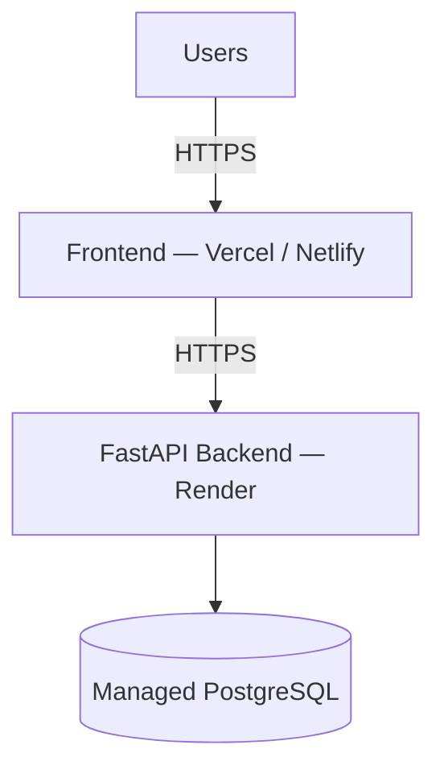

Public deployments run on synthetic data only.

---

## Development Roadmap

```mermaid
flowchart LR
    A[1. Requirements] --> B[2. Architecture + ERD]
    B --> C[3. DB + migrations]
    C --> D[4. Auth]
    D --> E[5. Walking skeleton]
    E --> F[6. Student portal]
    F --> G[7. Doctor workflow]
    G --> H[8. Prescription + dispensing]
    H --> I[9. 2nd doctor + redirect + no-show]
    I --> J[10. Queue polling]
    J --> K[11. RFID/NFC]
    K --> L[12. Admin + emergency]
    L --> M[13. Security + audit]
    M --> N[14. Testing]
    N --> O[15. Deployment]
    O --> P[16. Pilot + hardening]
    P --> Q[17. Stretch goals]
```

| Phase | Target |
|---|---|
| Requirements & architecture | Week 1 |
| Database & backend foundation | Week 2 |
| Walking skeleton | Week 3 |
| Student + doctor workflows | Weeks 4–5 |
| Queue + redirect + no-show | Week 6 |
| RFID + admin + emergency | Week 7 |
| Security + testing | Week 8 |
| Deployment + integration testing | Week 9 |
| Pilot + documentation + demo | Week 10 |
| Buffer / stretch goals | Remaining time |

---

## Definition of Done

A feature isn't done because its UI exists. It's done when every layer is addressed:

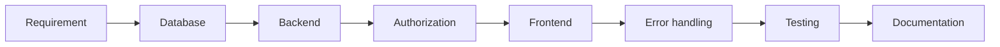

**Worked example — RFID check-in isn't "done" because a phone can read a UID.** It's done when:

`NFC card → UID read → credential verified → student identified → duplicate check → visit created → queue entry created → student sees queue → invalid/revoked card rejected`

---

## Engineering Principles

1. **Correctness over feature count** — a small system that works beats a large one that half-works.
2. **Backend is authoritative** — the client never decides role, permissions, queue state, identity, or prescription ownership.
3. **Explicit state transitions** — visits move through known states, never arbitrary status changes.
4. **Structured clinical data** — anything queried later isn't stored as unstructured text.
5. **Privacy by design** — development environments run on synthetic data.
6. **Scope discipline** — a feature earns a place only if it has a clear slot in the semester deliverable.

---

## Team

CampusCare — 4-person team, Thapar Institute of Engineering and Technology, UCS503P (5th Semester Software Engineering)

| Responsibility | Owner |
|---|---|
| Backend / API | TBD |
| Frontend / PWA | TBD |
| Database / Clinical Workflow | TBD |
| Infrastructure / Integration / RFID | TBD |

---

## Why This Belongs on a CV

Not the technology count — the fact that one workflow connects physical identity, software identity, queue management, clinical records, prescriptions, and dispensing, end to end, with the backend authoritative at every step.

`React` · `FastAPI` · `PostgreSQL` · `Raw SQL` · `Auth + RBAC` · `Web NFC` · `REST APIs` · `PWA` · `Real-time queueing` · `Transactions` · `Testing` · `Cloud deployment`

---

## License

To be decided by the team.

<div align="center">

**CampusCare** — from ID card tap to completed care.

</div>