<div align="center">

<!-- Animated Wave Header Banner (Clinical Teal / Emerald) -->


<br />


<br />

<!-- Animated Typing Tagline -->
<a href="https://campuscare-zpl9.onrender.com">
  
</a>

<p>
  <a href="https://campuscare-zpl9.onrender.com"><strong>Live Web App</strong></a> ·
  <a href="https://campuscarebackend-j203.onrender.com/docs"><strong>Swagger API Docs</strong></a> ·
  <a href="https://campuscarebackend-j203.onrender.com/ready"><strong>Live DB Readiness</strong></a> ·
  <a href="#-live-portals--demo-access"><strong>Portals &amp; Demo</strong></a> ·
  <a href="#-interactive-screen-gallery"><strong>Screen Gallery</strong></a> ·
  <a href="#-system-architecture"><strong>Architecture</strong></a> ·
  <a href="./Est_Report/Est_Report.pdf"><strong>Final EST Report</strong></a>
</p>

<!-- Live Status & Core Stack Badges -->
<p>
  <a href="https://campuscare-zpl9.onrender.com">
    
  </a>
  <a href="https://campuscarebackend-j203.onrender.com/health">
    
  </a>
  
  
  
  
  
  <a href="./LICENSE.md">
    
  </a>
</p>

<!-- Live GitHub Repository Telemetry Badges -->
<p>
  
  
  
  
  
  
</p>

<br />

<!-- Tech Stack Icon Row -->
<a href="#-technology-stack">
  
</a>

<br /><br />

<!-- Pinned Repo Card (Teal Theme) -->
<a href="https://github.com/LavdeepSingh23/CampusCare">
  
</a>

</div>

---

## Overview

**CampusCare** replaces paper registers, handwritten prescriptions, and chaotic clinic waiting lines with one synchronized, multi-portal digital health-centre platform built for campus dispensaries (developed for **UCS503P — Software Engineering**, 5th Semester at Thapar Institute).

Instead of issuing separate health cards or buying dedicated RFID hardware, CampusCare uses the **NFC chip already embedded inside existing college ID cards** (`ISO/IEC 14443-3A` tested on Android Chrome via Web NFC over HTTPS), connecting check-in, doctor queues, structured prescriptions, pharmacy dispensing, emergency dispatch, and morning analytics end-to-end.


---

## Live Portals & Demo Access

Both the frontend static app and FastAPI backend are live on **Render** backed by **Aiven Cloud MySQL 8.4** (`TLSv1.3`).

> [!TIP]
> Every login portal includes a built-in **"Use demo credentials"** one-click button directly under the Sign-In form so reviewers and testers can explore each workflow immediately without manual setup.

| Portal | Live Entry Route | Who Uses It | Quick Demo Button in UI |
|---|---|---|---|
| **Landing & Portal Picker** | [campuscare-zpl9.onrender.com](https://campuscare-zpl9.onrender.com/) | Everyone | Opens Student & Faculty modal + Clinical Staff links |
| **Student Portal** | [`/signin/student`](https://campuscare-zpl9.onrender.com/signin/student) | Students (`@thapar.edu`) | `Use demo credentials (Roll #1024030107)` or Google SSO |
| **Faculty & Dependents** | [`/signin/faculty`](https://campuscare-zpl9.onrender.com/signin/faculty) | Faculty & Family | `Use demo credentials (Dr. Rajesh Sharma)` or Google SSO |
| **Doctor OPD Console** | [`/signin/doctor`](https://campuscare-zpl9.onrender.com/signin/doctor) | Duty Doctors | `Use demo credentials (dr.kapoor@thapar.edu)` |
| **Reception & Pharmacy** | [`/signin/receptionist`](https://campuscare-zpl9.onrender.com/signin/receptionist) | Front Desk & Pharmacists | `Use demo credentials (Counter 1 / reception@thapar.edu)` |
| **Admin Analytics** | [`/admin/login`](https://campuscare-zpl9.onrender.com/admin/login) | Health Centre Admin | Analytics dashboard, PDF export & faculty directory |
| **Swagger / OpenAPI** | [`/docs`](https://campuscarebackend-j203.onrender.com/docs) | Developers | Interactive FastAPI endpoint explorer |

---

## Interactive Screen Gallery

Click any portal below to expand live screenshots from the deployed application.

<details open>
<summary><b>Landing Page, Role Selector &amp; Authentication</b> — Clean entry for Student, Faculty, Doctor &amp; Receptionist</summary>
<br />

| Landing &amp; Clinic Showcase | Role Sign-In Portal |
|:---:|:---:|
| 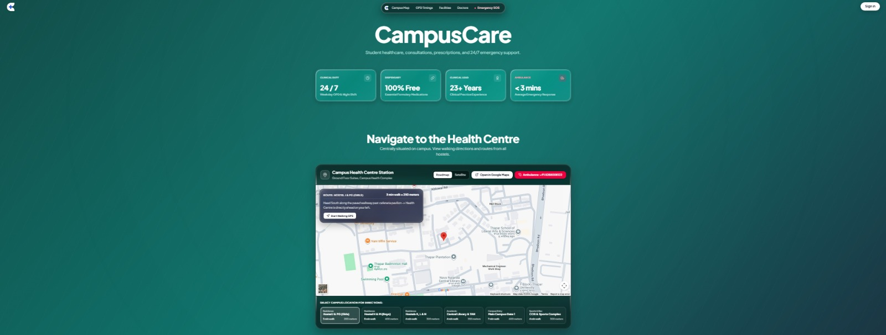 | 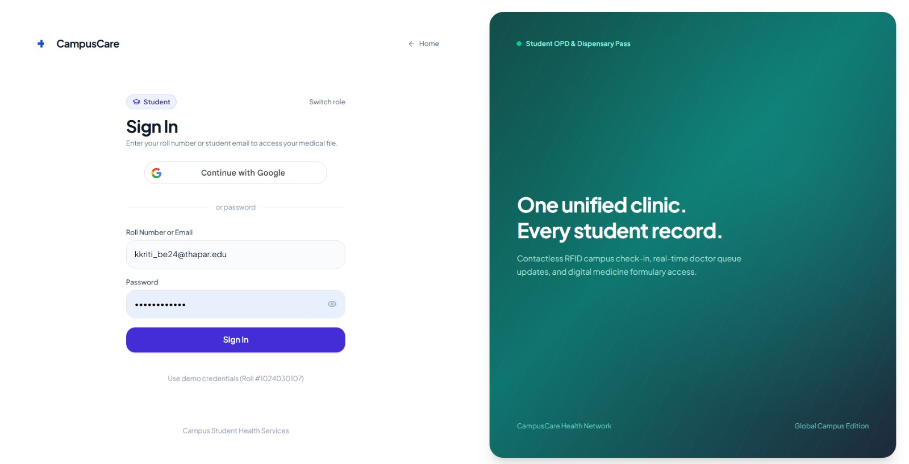 |

</details>

<details>
<summary><b>Student Portal &amp; Contactless NFC Check-In</b> — Live tokens, prescriptions, history &amp; Web NFC reads</summary>
<br />

| Student Dashboard | NFC Check-In Desk |
|:---:|:---:|
| 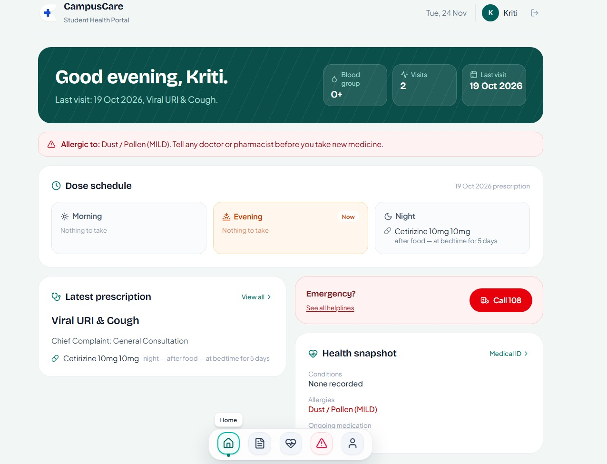 | 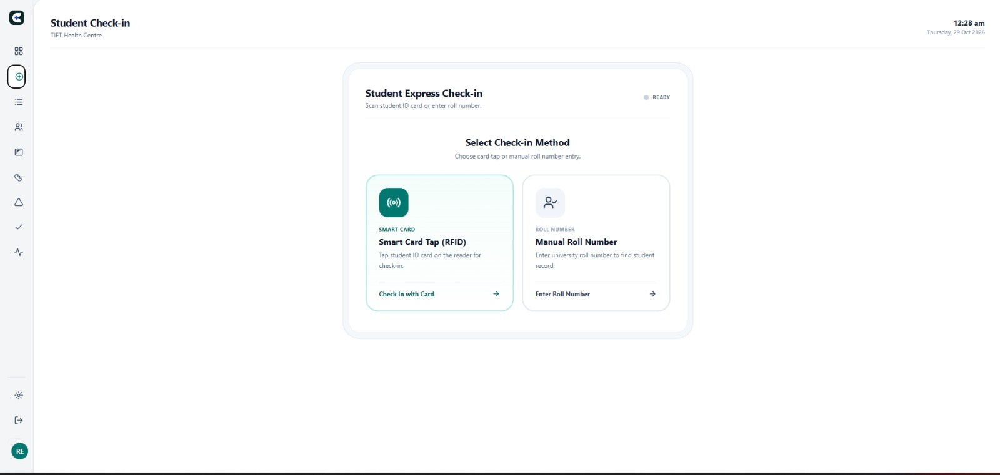 |

| Direct Medical Overview | Prescription &amp; History View |
|:---:|:---:|
| 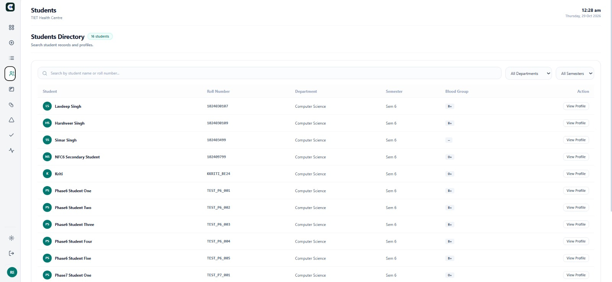 | 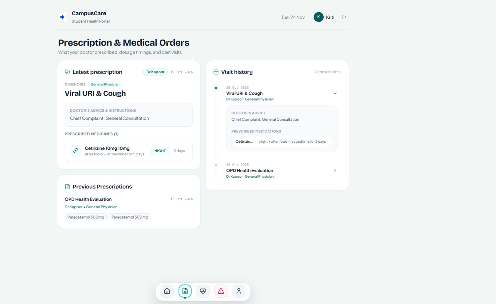 |

</details>

<details>
<summary><b>Doctor OPD Console &amp; E-Prescription Studio</b> — Allergy conflict alerts, formulary &amp; PDF Rx export</summary>
<br />

| Doctor OPD Live Workspace | Structured E-Prescription Studio |
|:---:|:---:|
| 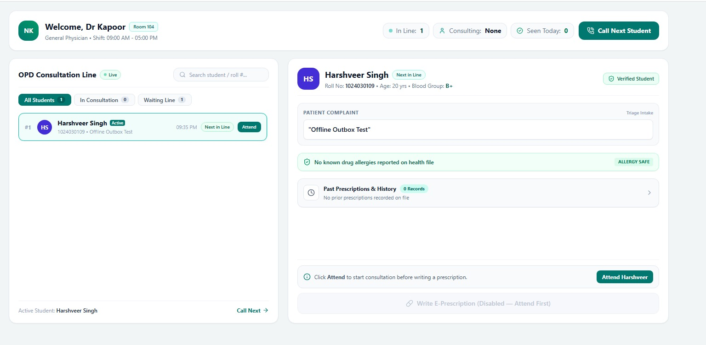 | 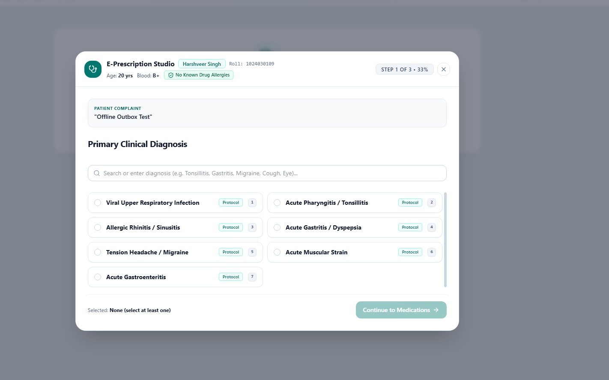 |

</details>

<details>
<summary><b>Receptionist Desk, Live Queue, Pharmacy Dispensing &amp; Emergency Dispatch</b></summary>
<br />

| Reception Check-In Desk | Live OPD Queue Monitor |
|:---:|:---:|
| 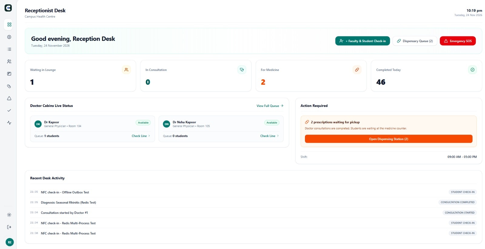 | 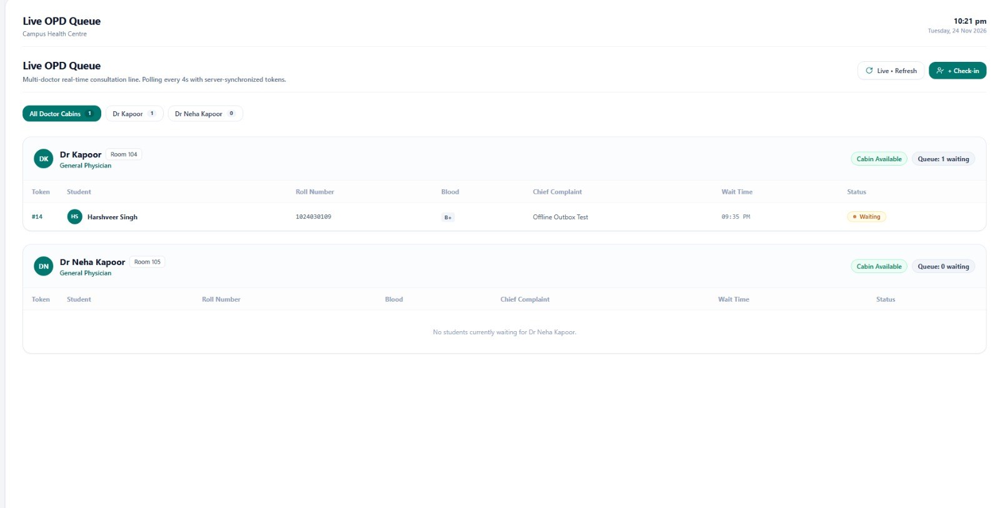 |

| Pharmacy Dispensing Station | Completed Visits Log |
|:---:|:---:|
| 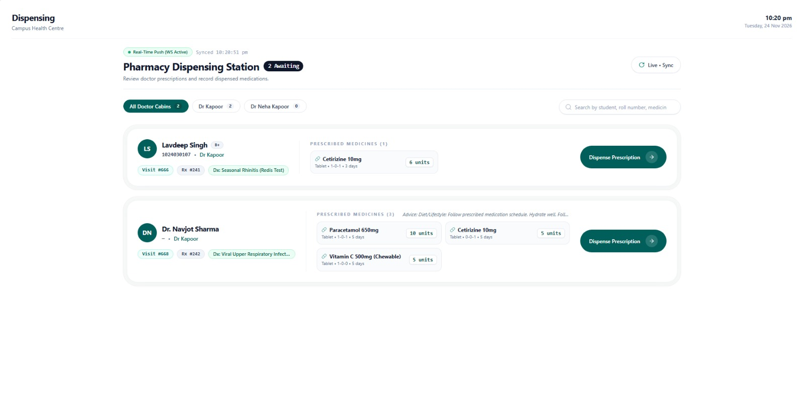 | 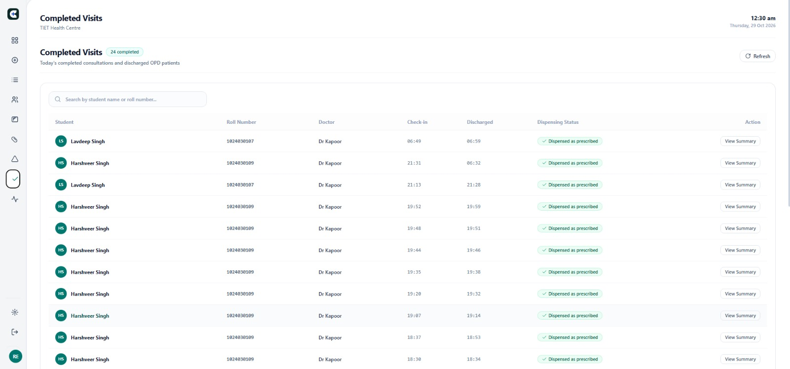 |

<div align="center">
  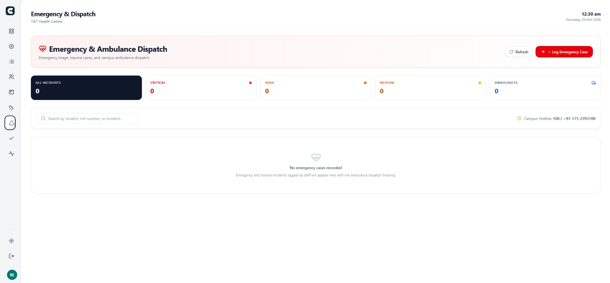
</div>

</details>

---

## Core Problems Solved

<details>
<summary><b>1. Real-Time OPD &amp; Dispensing Synchronization (No Polling Lag)</b></summary>
<br />

Previously, reception check-ins and completed consultations took several seconds to appear because clients polled repeatedly and triggered N+1 SQL waterfalls. CampusCare now pushes state changes in real time via **authenticated WebSockets** (`POST /api/ws/ticket` single-use handshake tickets), backed by a **MySQL Transactional Outbox** (`OUTBOX_EVENT` with `FOR UPDATE SKIP LOCKED`) and **Redis Pub/Sub**.
</details>

<details>
<summary><b>2. Structured Clinical Data &amp; Allergy Safety</b></summary>
<br />

Prescriptions avoid free-text boxes — every drug item stores strength, form, route, M-A-E-N schedule, duration, meal instruction, and allergy class (`medicineFormulary.js` + `prescriptionCalculations.js`), flagging patient allergy conflicts before finalization and rendering formal A4 PDF prescriptions (`jspdf`).
</details>

<details>
<summary><b>3. Faculty Dependents, Community Walk-Ins &amp; Isolated Emergency Triage</b></summary>
<br />

Staff can check in **Students** (NFC or roll lookup), **Faculty &amp; Registered Dependents** (institutional employee code lookup with auto-deduced dependent profiles), and **Community Walk-Ins**, while trauma/ambulance dispatches bypass the routine OPD queue in an isolated emergency pipeline.
</details>

<details>
<summary><b>4. Automated Morning Administrative Analytics &amp; Daily Email Digests</b></summary>
<br />

Built-in disease distribution analytics, shift-wise demographics (Student / Faculty / Community), PDF dashboard export, and an automated **09:00 AM IST** daily report pipeline delivered via **Resend**.
</details>

---

## System Architecture

CampusCare runs a three-tier architecture designed around **MySQL as the single source of truth**, **thread-safe connection pooling**, and **real-time cross-process event delivery**.

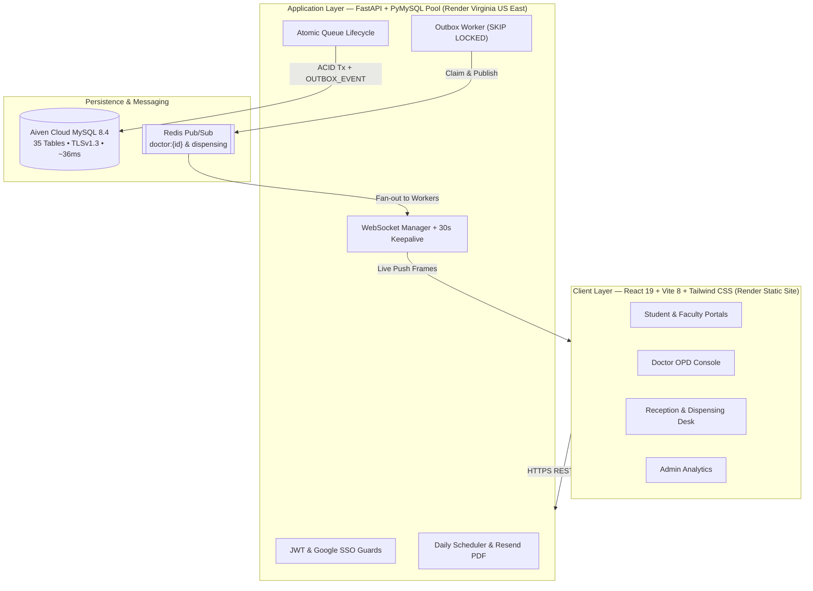

### Authoritative Visit State Machine

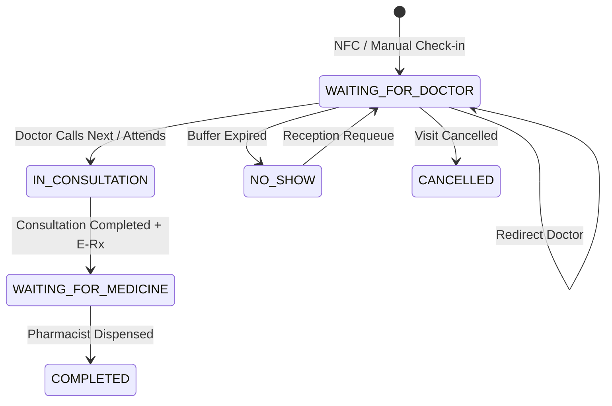

<details>
<summary><b>View Architecture, Use Case &amp; State Machine Diagrams from EST Report</b></summary>
<br />

| High-Level Architecture | Actor Use Case Diagram |
|:---:|:---:|
| 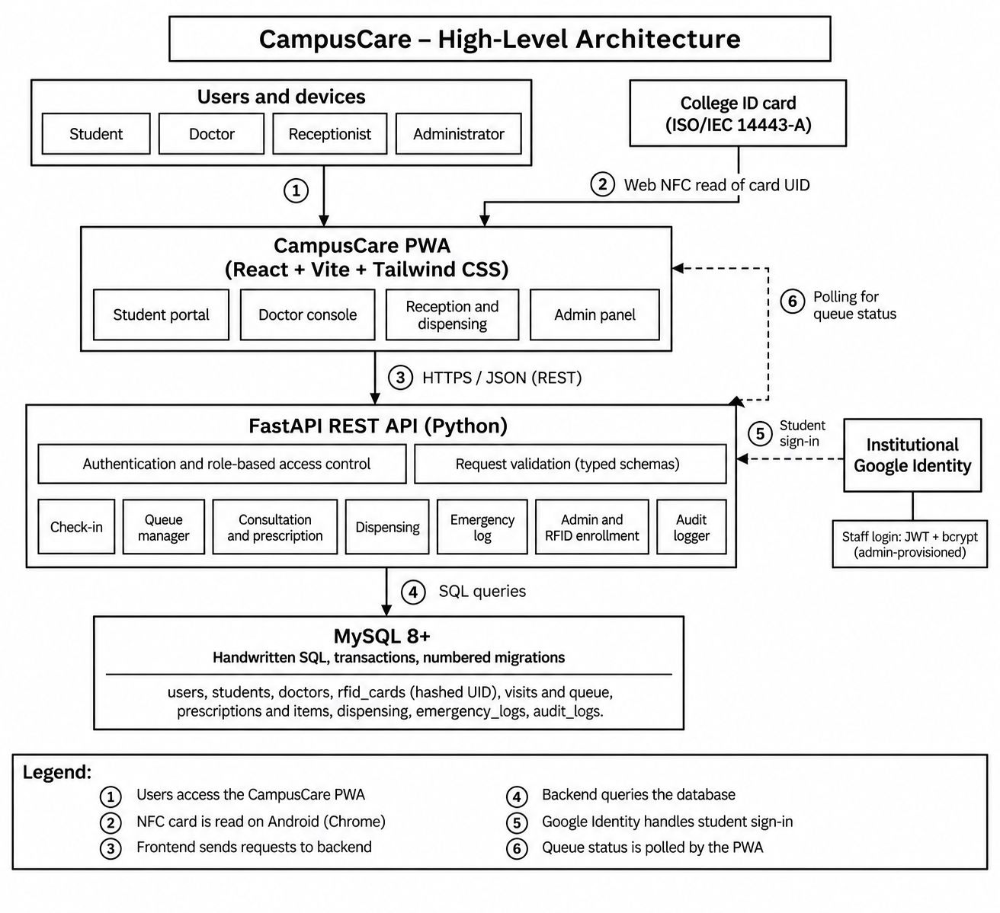 | 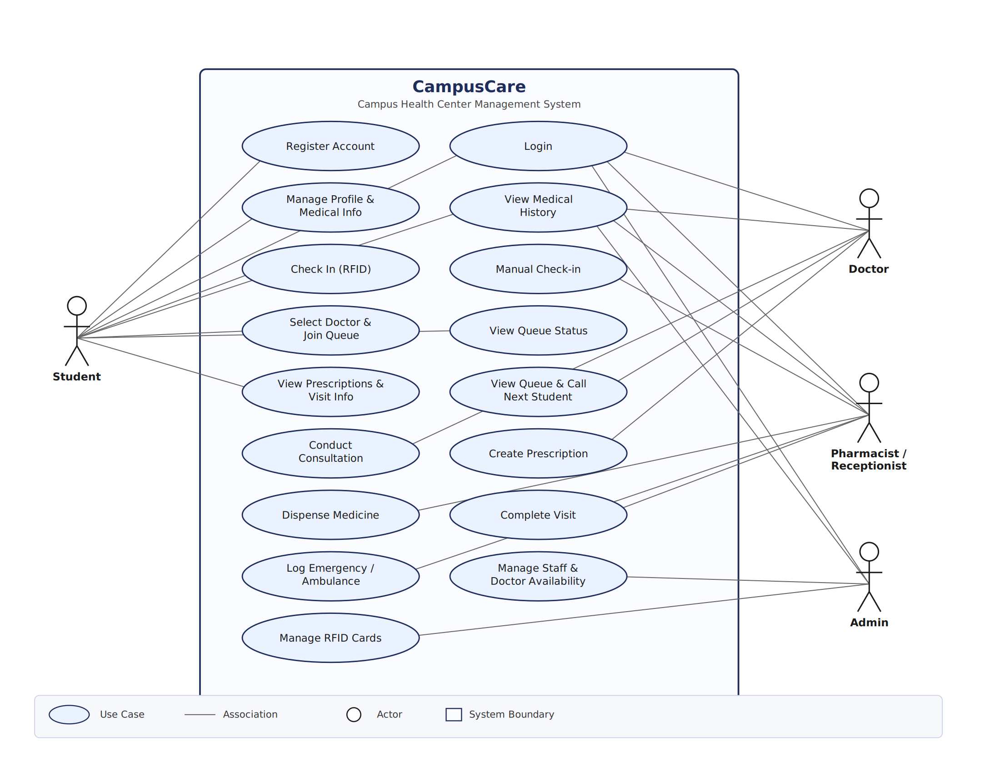 |

<div align="center">
  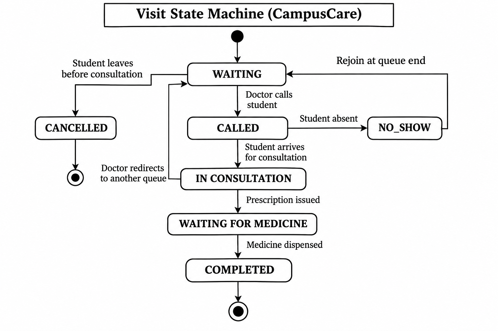
</div>

</details>

---

## Performance & Security Engineering

> [!IMPORTANT]
> **Security Invariants:**
> * Raw RFID/NFC card UIDs are **hashed before storage** — cards never store medical data.
> * Every protected route validates JWT role claims and doctor ownership on the **server**.
> * WebSockets authenticate with **single-use 60s handshake tickets** (`POST /api/ws/ticket`) and validate `Origin` headers — long-lived JWTs stay out of dispensing query strings, and WebSocket push frames carry zero clinical notes or medicine lists.

| Optimization / Hardening | Measured Result | Reference |
|---|---|---|
| **Render VA ↔ Aiven NY TLSv1.3 Pool** | **35.84 ms** live DB ping (down from ~533 ms cold WAN TLS) | [`production-hardening-report.md`](./docs/production-hardening-report.md) |
| **Dispensing Queue SQL Batching** | Replaced ~26 sequential N+1 queries with **3 batched `IN` queries** | [`queue_lifecycle.py`](./backend/app/services/queue_lifecycle.py) |
| **Doctor OPD Queue Render** | Eliminated 4-request waterfall with `event_id`-deduped instant push | [`Doctors_Dashboard.jsx`](./Code/frontend/src/Components/Doctors/Doctors_Dashboard.jsx) |
| **Cross-Process Distribution** | **0.15 ms** median Redis Pub/Sub dispatch, **0 lost events** on Redis outage | [`outbox.py`](./backend/app/services/outbox.py) |

---

## Project Status

| Module | Status | Implementation Highlights |
|---|:---:|---|
| Requirements &amp; Diagrams |  | Proposal, SRS, Mid-Sem Prototype, DFD L0–L2, UML &amp; EST Report |
| Database Schema (`01`–`33`) |  | Aiven Cloud MySQL 8.4 (`35` tables), raw PyMySQL pool + Outbox table |
| Auth &amp; 4-Portal RBAC |  | Google `@thapar.edu` SSO, JWT guards, Student/Faculty/Doctor/Reception/Admin |
| Queue, Consultation &amp; Dispense |  | Row-locked state machine, allergy checks, e-Rx PDF, partial dispensing |
| Web NFC &amp; Emergency Triage |  | Real college ID card tap-in over HTTPS + isolated ambulance dispatch |
| Real-Time WS + Outbox + Redis |  | Doctor &amp; Receptionist WebSockets, `SKIP LOCKED` outbox worker, Redis Pub/Sub |
| Admin Analytics &amp; Emails |  | Disease charts, demographic breakdown, PDF export, 9 AM IST Resend digests |
| Cloud Deployment &amp; QA |  | Live on Render + Aiven MySQL; end-to-end verified in Chrome |

---

## Technology Stack

| Layer | Technologies |
|---|---|
| **Frontend** | React 19 · Vite 8 · Tailwind CSS v4 · Framer Motion · Lucide Icons · Recharts · `jspdf` · `html2canvas` · Web NFC API |
| **Backend** | Python 3 · FastAPI · Uvicorn · `PyMySQL` (custom TLS connection pool) · `python-jose` · `bcrypt` · `google-auth` · `redis.asyncio` · Resend |
| **Database &amp; Bus** | Aiven Cloud MySQL 8.4 (`01`–`33` ordered SQL migrations) · Transactional Outbox (`FOR UPDATE SKIP LOCKED`) · Redis Pub/Sub |
| **Hosting &amp; Docs** | Render Static Site + Render Web Service (`Virginia US East`) · LaTeX (`tietreport.cls`) · Mermaid |

---

## Repository Structure

```text
CampusCare/
├── Code/frontend/                  # React 19 + Vite 8 + Tailwind CSS frontend
│   ├── src/Components/             # Auth, Student, Faculty, Doctor, Receptionist, Admin & Landing UI
│   ├── src/context/AuthContext.jsx # Multi-role session management
│   ├── src/utils/                  # E-prescription PDF & dosage calculators
│   └── src/api.js                  # Centralized REST client
│
├── backend/                        # FastAPI application (Render root directory)
│   ├── app/
│   │   ├── api/routes/             # auth, student, faculty, doctor, reception, queue, queue_ws, rfid, emergency, admin, health
│   │   ├── core/                   # config, database (PyMySQL pool), redis_client, security, rate_limiter, deps
│   │   ├── services/               # queue_lifecycle, outbox, queue_ws_manager, analytics_aggregator, pdf_report_generator, daily_scheduler
│   │   └── schemas/                # Pydantic request/response contracts
│   ├── sql/                        # 33 ordered MySQL migrations (01_User_Account.sql -> 33_outbox_event.sql)
│   ├── tests/                      # Concurrency, queue lifecycle, emergency & DB flow test suites
│   └── requirements.txt            # Production dependencies (fastapi, pymysql, redis, google-auth[requests], ...)
│
├── docs/                           # API contract, queue lifecycle & performance/hardening audit reports
├── Est_Report/                     # Final EST LaTeX report (main.tex, tietreport.cls, Est_Report.pdf & 16 figures)
├── Journal/                        # Per-member weekly engineering journals (Weeks 1–8)
├── Project_Report_Prototype/       # Mid-semester prototype report
├── Software Requirement Specification/
└── project proposal/
```

---

## Getting Started (Local Development)

<details>
<summary><b>Click to expand local setup commands &amp; environment variables</b></summary>

### Prerequisites
* `Git` · `Node.js 18+` · `Python 3.11+` · MySQL 8.x (or Aiven MySQL credentials) · *(Optional)* Redis server if testing `USE_REDIS_PUBSUB=true`

### 1. Clone &amp; Start Backend
```bash
git clone https://github.com/LavdeepSingh23/CampusCare.git
cd CampusCare/backend

python -m venv .venv
# Windows: .venv\Scripts\activate
# macOS/Linux: source .venv/bin/activate

pip install -r requirements.txt
uvicorn app.main:app --host 127.0.0.1 --port 8000 --reload
```

### 2. Start Frontend
```bash
cd ../Code/frontend
npm install
npm run dev
```

### 3. Apply SQL Migrations (if provisioning a fresh MySQL schema)
Run scripts in [`backend/sql/`](./backend/sql) sequentially from `01_User_Account.sql` through `33_outbox_event.sql`.

### 4. Backend Environment Variables (`backend/.env`)
```ini
ENVIRONMENT=development
DB_MODE=mysql
DB_HOST=<mysql-host>
DB_PORT=<mysql-port>
DB_NAME=campuscare_dev
DB_USER=<mysql-user>
DB_PASSWORD=<mysql-password>
DB_SSL_MODE=REQUIRED
JWT_SECRET_KEY=<random-secret>
CORS_ORIGINS=http://localhost:5173,http://127.0.0.1:5173
GOOGLE_CLIENT_ID=<google-oauth-client-id>
RESEND_API_KEY=<resend-api-key>
USE_REDIS_PUBSUB=false
```

</details>

---

## Team &amp; Weekly Journals

Built for **UCS503P — Software Engineering** at Thapar Institute of Engineering and Technology:

| Member | Roll No | Core Responsibilities | Weekly Journal |
|---|---|---|---|
| **Lavdeep Singh** | `1024030107` | Backend FastAPI architecture, auth/RBAC, queue lifecycle, WebSockets, PyMySQL pooling, Outbox + Redis Pub/Sub, Render cloud deployment | [Lavdeep Journal (W1–W8)](./Journal/1024030107-Lavdeep%20Singh/index.md) |
| **Harshveer Singh** | `1024030109` | Frontend dashboards, prescription UI/UX formulary, e-Rx PDF generation, Admin disease charts, branding &amp; repo styling | [Harshveer Journal (W1–W6)](./Journal/1024030109-Harshveer%20Singh/index_w6.md) |
| **Kriti** | `1024030111` | MySQL schema (`01`–`25`), SQL mitigation scripts (`26`–`32`), SRS, Project Proposal, UML/State/Architecture diagrams &amp; live Render QA | [Kriti Journal (W1–W8)](./Journal/1024030111-Kriti/index.md) |
| **Damanbir Singh** | `1024030110` | Project proposal contributions and Level 2 DFD workflow documentation | [Daman Journal](./Journal/1024030110-Daman/w2-dfd-documentation.md) |

---

## Repository Activity &amp; Contributors

<div align="center">


<br /><br />

<a href="https://github.com/LavdeepSingh23/CampusCare/graphs/contributors">
  
</a>

</div>

---

## License

Licensed under **The Prosperity Public License 3.0.0** — see [`LICENSE.md`](./LICENSE.md) for terms.

<div align="center">


</div>
