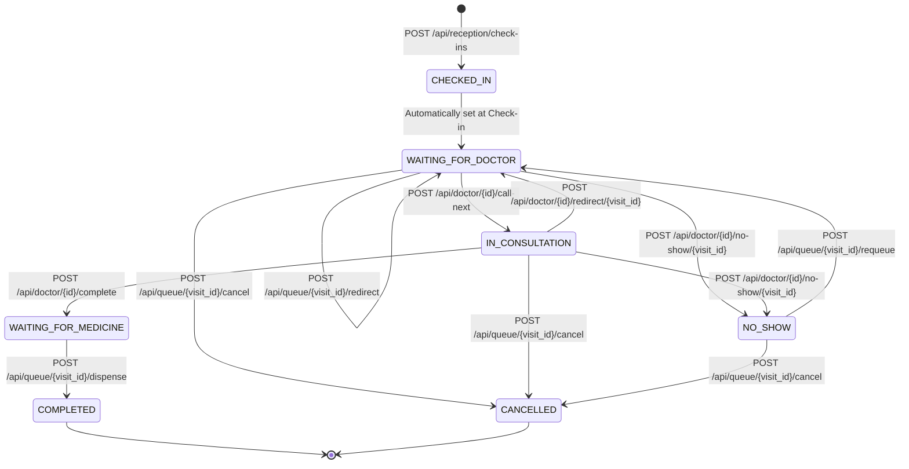

# CampusCare API Integration Contract

> **Target Audience**: Frontend Engineers, Integration Partners, and Backend Developers.  
> **Environment**: CampusCare Clinic Management System (FastAPI + MySQL / Aiven Cloud).  
> **Status**: Frozen & Implemented. All endpoints documented herein are verified by automated backend and integration tests.

---

## 1. Core Integration Principles

### 1.1 Server-Authoritative State & Queue Numbering
- **Never Spoof or Client-Generate Sequence Numbers**: Queue sequence numbers (`queueNo` / `queue_sequence`) and visit IDs (`visitId` / `visit_id`) are exclusively generated and allocated by the server within serialized database transactions holding doctor row locks (`SELECT doctor_id FROM DOCTOR ... FOR UPDATE`).
- **Gaps in Sequences**: Sequence numbers are strictly unique and monotonically increasing per doctor per calendar date. Sequence gaps resulting from cancellations, redirects, or rollbacks are natural and intentional; frontends must never re-index or re-number displayed tokens.

### 1.2 Dual-Cased JSON Serialization
To prevent integration breaks between JavaScript frontend conventions (`camelCase`) and Python/SQL backend conventions (`snake_case`), all queue and reception responses provide **both casings** simultaneously:
```json
{
  "visitId": 105,
  "visit_id": 105,
  "queueNo": 3,
  "queue_number": 3,
  "queue_sequence": 3,
  "rollNumber": "CS21B045",
  "roll_number": "CS21B045",
  "doctor_id": 1,
  "doctorId": 1,
  "status": "Waiting"
}
```
Frontend developers may safely access either `item.visitId` or `item.visit_id`.

### 1.3 Authentication & Header Format
All authenticated endpoints require an `Authorization` header containing a valid Bearer JWT:
```http
Authorization: Bearer <access_token>
```
The token is obtained via `POST /api/auth/login`. Tokens encode the user's role (`DOCTOR`, `RECEPTIONIST`, or `STUDENT`), `user_id`, `staff_id`, and `doctor_id`. The backend derives actor identity exclusively from the validated token.

---

## 2. Standardized Error Handling

All error responses from FastAPI and CampusCare services follow a uniform structure:

```json
{
  "detail": "Human-readable explanation of the error"
}
```

Or for internal database-level faults:
```json
{
  "error": "ActiveVisitConflictError",
  "message": "Student CS21B045 already has an active visit (visit_id=105, status=WAITING_FOR_DOCTOR).",
  "detail": "Cannot create a new visit until the active visit is completed or cancelled.",
  "path": "/api/reception/check-ins"
}
```

### 2.1 HTTP Status Code Directory

| HTTP Status | Semantic Meaning | Common Causes in CampusCare | Frontend Action |
|---|---|---|---|
| **`200 OK`** | Success | Request succeeded. | Update UI state with response data. |
| **`201 Created`** | Created | Check-in created new visit + queue entry. | Display allocated token & position to staff. |
| **`400 Bad Request`** | Client Payload Error | Malformed JSON or invalid transition attempt. | Display validation error message. |
| **`401 Unauthorized`** | Missing or Expired Token | Token missing, signature invalid, or expired. | Clear local session; redirect to `/login`. |
| **`403 Forbidden`** | Insufficient Role Privileges | Doctor accessing another doctor's workstation; student accessing staff queue. | Show "Access Denied: unauthorized workstation". |
| **`404 Not Found`** | Missing Resource | Student roll number, doctor ID, or visit ID does not exist in DB. | Display "Record not found". |
| **`409 Conflict`** | Lifecycle Conflict | Duplicate active visit, unavailable doctor, or invalid status transition. | Display specific error message without logging out. |
| **`422 Unprocessable`** | Missing Required Field | Missing `roll_number` or `doctor_id` in request body. | Highlight missing input field in form. |
| **`500 Internal Error`** | Server / Database Error | Unexpected database failure or deadlock exhaustion. | Show "System error. Please retry shortly." |
| **`503 Service Unavailable`** | DB Unreachable | Aiven MySQL rejected connections or timed out. | Show "Service temporarily offline." |

### 2.2 Domain Conflict Strings (HTTP 409)
The frontend can check `error.message` or `error.response.data.detail` against these standard patterns:
- **`Student ... already has an active visit`**: Student is currently in queue or consultation.
- **`Doctor ... is unavailable on ...`**: Selected doctor has an active `UNAVAILABLE` record today.
- **`Doctor already has an active consultation in progress`**: Doctor must finish or redirect current patient before calling another.
- **`Cannot transition visit ... from COMPLETED`**: Transition attempted on terminal visit.
- **`Visit ... is not in NO_SHOW status`**: Requeue attempted on non-no-show visit.

---

## 3. Patient & Queue Record Data Contracts

### 3.1 Patient Display Fields in Queue Rows
When displaying queue tables for front desk or doctor queues, each patient item contains the following verified fields:

| Field (`camelCase` / `snake_case`) | Type | Nullable | Description | Example |
|---|---|---|---|---|
| `visitId` / `visit_id` | `int` | No | Overarching clinic visit identifier. | `105` |
| `queueEntryId` / `queue_entry_id` | `int` | No | Current doctor queue record identifier. | `240` |
| `rollNumber` / `roll_number` / `rollNo` | `string` | No | Student unique university roll number. | `"CS21B045"` |
| `name` / `student_name` | `string` | No | Student full display name. | `"Aarav Mehta"` |
| `bloodGroup` / `blood_group` | `string` | Yes | Student blood group. | `"O+"` |
| `age` | `int` | Yes | Calculated age based on date of birth. | `21` |
| `doctorId` / `doctor_id` | `int` | No | Assigned doctor ID. | `1` |
| `doctorName` / `doctor_name` | `string` | Yes | Assigned doctor's formatted name. | `"Dr. Neha Kapoor"` |
| `doctorEmail` / `doctor_email` | `string` | Yes | Assigned doctor's campus email. | `"nkapoor@thapar.edu"` |
| `specialty` | `string` | Yes | Doctor's medical specialty. | `"General Physician"` |
| `room` | `string` | Yes | Assigned clinic examination room. | `"Room 104"` |
| `queueNo` / `queue_number` / `sequence` | `int` | No | Daily queue sequence number for this doctor. | `4` |
| `status` | `string` | No | Human-readable UI status (`"Waiting"` or `"In Consultation"`). | `"Waiting"` |
| `statusCode` / `queue_status` | `string` | No | Machine-readable status of the queue entry. | `"WAITING"` or `"IN_CONSULTATION"` |
| `visitStatus` / `visit_status` | `string` | No | Overarching visit status. | `"WAITING_FOR_DOCTOR"`, `"IN_CONSULTATION"` |
| `checkInTime` / `checkedInAt` | `string` (ISO) | Yes | Timestamp when student checked in. | `"2026-10-18T10:15:00"` |
| `waitingSince` | `string` | Yes | Formatted local check-in time for UI cards. | `"10:15 AM"` |
| `calledAt` / `called_at` | `string` | Yes | Timestamp/time when called into consultation. | `"10:32 AM"` |
| `complaint` | `string` | Yes | Chief complaint or entry reason. | `"Fever & persistent cough"` |

### 3.2 Student Privacy & Data Minimization Rules
To comply with medical confidentiality and student data protection:
- **Do NOT expose in queue rows**: Full home addresses, guardian phone numbers, GPA/grades, full date of birth, emergency contact notes, or past medical records.
- **Detailed Clinical History**: Medical conditions, past prescriptions, and active allergies are strictly quarantined to the doctor consultation endpoints (`/api/patient/{roll_number}/summary` and `/api/patient/{roll_number}/history`) and are never included in front-desk public queue lists.

---

## 4. Canonical Route Directory & Implementation Matrix

| Operation | Canonical Route | Alternative / Deprecated Aliases | Implemented? |
|---|---|---|---|
| **Receptionist Check-In** | `POST /api/reception/check-ins` | `POST /api/reception/checkin`<br>`POST /api/queue/checkin` | **YES** |
| **Front-Desk Queue View** | `GET /api/reception/queue` | `GET /api/queue/live` | **YES** |
| **Reception Doctors List** | `GET /api/reception/doctors` | — | **YES** |
| **Reception Student Lookup** | `GET /api/reception/students/{roll_number}` | — | **YES** |
| **Doctor Own Queue** | `GET /api/doctor/{doctor_id}/queue` | — | **YES** |
| **Doctor Active Consultation** | `GET /api/doctor/{doctor_id}/active-consultation` | — | **YES** |
| **Doctor Call Next** | `POST /api/doctor/{doctor_id}/call-next` | `POST /api/doctor/{doctor_id}/start-consultation` (without body) | **YES** |
| **Doctor Start Consultation** | `POST /api/doctor/{doctor_id}/start-consultation/{visit_id}` | `POST /api/queue/{visit_id}/start-consultation` | **YES** |
| **Complete Consultation** | `POST /api/doctor/{doctor_id}/complete` | `POST /api/doctor/{doctor_id}/complete/{visit_id}` | **YES** |
| **Mark Patient No-Show** | `POST /api/doctor/{doctor_id}/no-show/{visit_id}` | `POST /api/queue/{visit_id}/no-show` | **YES** |
| **Requeue Patient** | `POST /api/queue/{visit_id}/requeue` | — | **YES** |
| **Redirect Patient** | `POST /api/queue/{visit_id}/redirect` | `POST /api/doctor/{doctor_id}/redirect/{visit_id}` | **YES** |
| **Dispense Medication** | `POST /api/queue/{visit_id}/dispense` | `POST /api/reception/dispense/{visit_id}` | **YES** |
| **Awaiting Dispense List** | `GET /api/queue/awaiting-dispense` | `GET /api/reception/prescriptions/awaiting-dispense`<br>`GET /api/reception/dispensing` | **YES** |
| **Visit Prescription Detail** | `GET /api/queue/{visit_id}/prescription` | `GET /api/reception/prescriptions/{visit_id}` | **YES** |
| **Cancel Visit** | `POST /api/queue/{visit_id}/cancel` | — | **YES** |

| **Doctor Daily Stats** | `GET /api/doctor/{doctor_id}/stats` | — | **YES** |
| **Patient Medical Summary** | `GET /api/patient/{roll_number}/summary` | — | **YES** |
| **Patient Medical History** | `GET /api/patient/{roll_number}/history` | — | **YES** |
| **Staff Authentication** | `POST /api/auth/login` | — | **YES** |
| *Student Self-Checkin Kiosk* | *`POST /api/kiosk/check-in`* | — | *PLANNED* |
| *Real-time WebSocket Push* | *`WS /api/ws/queue`* | — | *PLANNED* |

---

## 5. Detailed Endpoint Specifications

### 5.1 Authentication: Staff Login

- **Route**: `POST /api/auth/login`
- **Authorization**: Public (No auth header required)
- **Request Body**:
  ```json
  {
    "email": "reception@thapar.edu", // string, required
    "password": "Password123!"       // string, required
  }
  ```
- **Success Response (`200 OK`)**:
  ```json
  {
    "access_token": "eyJhbGciOi...",
    "token_type": "bearer",
    "role": "RECEPTIONIST",          // "DOCTOR" or "RECEPTIONIST"
    "name": "Front Desk Reception",
    "doctor_id": null,               // int for doctors, null for receptionists
    "specialty": null                // string for doctors, null for receptionists
  }
  ```
- **Error Responses**:
  - `401 Unauthorized`: Incorrect email or password.
  - `403 Forbidden`: Account is inactive or disabled.
- **Retry Safety**: Safe and idempotent.

---

### 5.2 Reception: Student Check-In (Canonical)

- **Route**: `POST /api/reception/check-ins`  
  *(Aliases: `POST /api/reception/checkin`, `POST /api/queue/checkin`)*
- **Authorization**: `RECEPTIONIST` role only.
- **Request Body**:
  ```json
  {
    "roll_number": "CS21B045",                  // string, required (or rollNumber)
    "doctor_id": 1,                             // int, required (or doctorId)
    "complaint": "Persistent cough and fever",  // string, optional (default: "General Consultation")
    "via": "MANUAL"                             // string, optional: "MANUAL" or "RFID"
  }
  ```
- **Success Response (`201 Created`)**:
  ```json
  {
    "visitId": 105,
    "visit_id": 105,
    "queueNo": 4,
    "queue_number": 4,
    "sequence": 4,
    "doctorId": 1,
    "doctor_id": 1,
    "status": "Waiting",
    "position": 3,
    "name": "Aarav Mehta",
    "rollNumber": "CS21B045",
    "roll_number": "CS21B045",
    "queueEntryId": 240,
    "queue_entry_id": 240
  }
  ```
- **Error Responses**:
  - `401 Unauthorized`: Missing or invalid token.
  - `403 Forbidden`: Caller is a DOCTOR or STUDENT.
  - `404 Not Found`: Student roll number or doctor ID does not exist.
  - `409 Conflict`: 
    - Student already has an active visit in progress.
    - Selected doctor is unavailable today (`DOCTOR_AVAILABILITY`).
  - `422 Unprocessable Entity`: Missing `roll_number` or `doctor_id`.
- **Side Effects**:
  - Inserts new row in `VISIT` (`status = 'WAITING_FOR_DOCTOR'`, `checked_in_at = NOW()`).
  - Inserts new row in `QUEUE_ENTRY` (`status = 'WAITING'`, `queue_sequence = next_seq`, `entry_reason = 'INITIAL_CHECKIN'`).
  - Inserts audit row in `VISIT_EVENT` (`event_type = 'CHECKED_IN'`).
- **Retry Safety**: **Non-idempotent**. Retrying check-in for the same student while the first visit is waiting returns `409 Conflict` (Single Active Visit constraint).

---

### 5.3 Reception: Overall Queue View

- **Route**: `GET /api/reception/queue`  
  *(Optional Filter: `GET /api/reception/queue?doctor_id=1`)*
- **Authorization**: `RECEPTIONIST` role only.
- **Request Parameters**:
  - `doctor_id` (`int`, query param, optional): When provided, restricts results to that doctor. When omitted, returns active queues across all doctors.
- **Success Response (`200 OK`)**:
  ```json
  [
    {
      "queueEntryId": 240,
      "queue_entry_id": 240,
      "visitId": 105,
      "visit_id": 105,
      "rollNumber": "CS21B045",
      "roll_number": "CS21B045",
      "rollNo": "CS21B045",
      "name": "Aarav Mehta",
      "student_name": "Aarav Mehta",
      "bloodGroup": "O+",
      "blood_group": "O+",
      "doctorId": 1,
      "doctor_id": 1,
      "doctorName": "Dr. Neha Kapoor",
      "doctor_name": "Dr. Neha Kapoor",
      "doctorEmail": "nkapoor@thapar.edu",
      "specialty": "General Physician",
      "room": "Room 104",
      "queueNo": 1,
      "queue_number": 1,
      "queue_sequence": 1,
      "status": "In Consultation",
      "statusCode": "IN_CONSULTATION",
      "queueStatus": "IN_CONSULTATION",
      "queue_status": "IN_CONSULTATION",
      "visitStatus": "IN_CONSULTATION",
      "visit_status": "IN_CONSULTATION",
      "checkInTime": "2026-10-18T10:15:00",
      "waitingSince": "10:15 AM",
      "calledAt": "10:32 AM",
      "called_at": "2026-10-18T10:32:00",
      "complaint": "Persistent cough"
    }
  ]
  ```
- **Error Responses**:
  - `401 Unauthorized`: Missing or invalid token.
  - `403 Forbidden`: Non-receptionist token.
- **Retry Safety**: Safe, read-only idempotency.

---

### 5.4 Doctor: Individual Doctor Queue

- **Route**: `GET /api/doctor/{doctor_id}/queue`
- **Authorization**: 
  - `DOCTOR`: Authenticated doctor ID must strictly match `{doctor_id}`.
  - `RECEPTIONIST`: Permitted for triage and coordination.
  - `STUDENT`: `403 Forbidden`.
- **Success Response (`200 OK`)**:
  Same patient item structure as Section 5.3, containing entries where `status IN ('IN_CONSULTATION', 'WAITING')`.
- **Error Responses**:
  - `401 Unauthorized`: Missing or expired token.
  - `403 Forbidden`: Doctor attempting to access another doctor's queue (`current.doctor_id != doctor_id`).
- **Retry Safety**: Safe, read-only idempotency.

---

### 5.5 Doctor: Active Consultation Status

- **Route**: `GET /api/doctor/{doctor_id}/active-consultation`
- **Authorization**: Doctor workstation token (matches `{doctor_id}`).
- **Success Response (`200 OK`) — Active Patient**:
  ```json
  {
    "active": true,
    "patient": {
      "queueEntryId": 240,
      "visitId": 105,
      "rollNumber": "CS21B045",
      "name": "Aarav Mehta",
      "queueNo": 1,
      "calledAt": "10:32 AM",
      "age": 21,
      "bloodGroup": "O+"
    }
  }
  ```
- **Success Response (`200 OK`) — Workstation Idle**:
  ```json
  {
    "active": false,
    "patient": null
  }
  ```
- **Error Responses**:
  - `401 Unauthorized`: Invalid/missing token.
  - `403 Forbidden`: Non-doctor caller or accessing another doctor's workstation.
- **Retry Safety**: Safe, read-only idempotency.

---

### 5.6 Doctor: Call Next Eligible Student

- **Route**: `POST /api/doctor/{doctor_id}/call-next`
- **Authorization**: Doctor workstation token (matches `{doctor_id}`).
- **Request Body**: Empty or `{}`.
- **Success Response (`200 OK`)**:
  ```json
  {
    "status": "in_consultation",       // or "already_in_consultation"
    "queueEntryId": 240,
    "visitId": 105,
    "rollNumber": "CS21B045",
    "name": "Aarav Mehta",
    "queueNo": 2,
    "message": "Called Aarav Mehta for consultation"
  }
  ```
- **Error Responses**:
  - `401 Unauthorized`: Missing or expired token.
  - `403 Forbidden`: Cross-doctor call attempt.
  - `404 Not Found`: No waiting patients left in this doctor's queue.
- **Side Effects**:
  - Advances highest-priority `WAITING` entry to `IN_CONSULTATION`.
  - Sets `called_at = NOW()`.
  - Sets `VISIT.status = 'IN_CONSULTATION'` and `consultation_started_at = NOW()`.
  - Inserts `VISIT_EVENT` (`event_type = 'CONSULTATION_STARTED'`).
- **Retry Safety**: **Idempotent**. If called while a consultation is already active, returns `"already_in_consultation"` with the existing patient without skipping or advancing subsequent students.

---

### 5.7 Doctor: Start Consultation by Specific Visit ID

- **Route**: `POST /api/doctor/{doctor_id}/start-consultation/{visit_id}`  
  *(Alias: `POST /api/queue/{visit_id}/start-consultation`)*
- **Authorization**: Doctor workstation token (matches `{doctor_id}`).
- **Request Body**: Empty or `{}`.
- **Success Response (`200 OK`)**: Same schema as `call-next`.
- **Error Responses**:
  - `404 Not Found`: Visit does not exist or is not assigned to this doctor.
  - `409 Conflict`: 
    - Doctor already has a *different* active consultation in progress.
    - Visit is not in `WAITING_FOR_DOCTOR` or `CALLED` state.
- **Retry Safety**: **Idempotent** for the same active visit.

---

### 5.8 Doctor: Complete Consultation & Finalize Prescription

- **Route**: `POST /api/doctor/{doctor_id}/complete`  
  *(Canonical Visit Route: `POST /api/doctor/{doctor_id}/complete/{visit_id}`)*
- **Authorization**: Doctor workstation token (token must match `{doctor_id}`, and doctor must be assigned to the visit).
- **Request Body**:
  ```json
  {
    "visit_id": 105,                       // integer, optional (canonical identifier; can also be supplied in path)
    "roll_number": "CS21B045",              // string, optional (fallback lookup for active consultation)
    "diagnosis": "Acute Bronchitis",        // string, required (non-empty)
    "reason_for_visit": "Persistent cough", // string, optional (defaults to diagnosis or General Consultation)
    "clinical_notes": "Chest clear, mild wheeze", // string, optional
    "general_instructions": "Rest for 3 days and drink warm fluids", // string, optional (alias: general)
    "medicines": [                          // array, optional
      {
        "name": "Amoxicillin 500mg",        // string, required
        "strength": "500mg",                // string, optional
        "dosage_form": "Capsule",           // string, optional (Tablet, Capsule, Syrup, etc.)
        "route": "Oral",                    // string, optional
        "duration_value": 5,                // integer, optional
        "duration_unit": "DAY",             // enum('DAY', 'WEEK', 'MONTH'), optional
        "meal_relation": "AFTER_MEAL",      // enum('BEFORE_MEAL', 'AFTER_MEAL', 'WITH_MEAL', 'ANY_TIME', 'NOT_APPLICABLE'), optional
        "special_instructions": "Take with water after meals", // string, optional
        "morning": true,                    // boolean, optional
        "afternoon": false,                 // boolean, optional
        "evening": false,                   // boolean, optional
        "night": true,                      // boolean, optional
        "dose_quantity": 1.0,               // float, optional (default 1.0)
        "dose_unit": "capsule",             // string, optional (default 'dose')
        "doses": [                          // array, optional explicit dose schedules
          {
            "time_of_day": "MORNING",       // enum('MORNING', 'AFTERNOON', 'EVENING', 'NIGHT'), required
            "dose_quantity": 1.0,           // float, positive
            "dose_unit": "capsule"          // string
          },
          {
            "time_of_day": "NIGHT",
            "dose_quantity": 1.0,
            "dose_unit": "capsule"
          }
        ]
      }
    ]
  }
  ```
- **Success Response (`200 OK`)**:
  ```json
  {
    "status": "ok",
    "prescription_id": 45,
    "prescriptionId": 45,
    "consultation_id": 82,
    "consultationId": 82,
    "visit_id": 105,
    "visitId": 105,
    "roll_number": "CS21B045",
    "rollNumber": "CS21B045",
    "doctor_id": 1,
    "doctorId": 1,
    "diagnosis": "Acute Bronchitis",
    "reason_for_visit": "Persistent cough",
    "reasonForVisit": "Persistent cough",
    "clinical_notes": "Chest clear, mild wheeze",
    "clinicalNotes": "Chest clear, mild wheeze",
    "general_instructions": "Rest for 3 days and drink warm fluids",
    "generalInstructions": "Rest for 3 days and drink warm fluids",
    "finalized_at": "2026-10-19T17:15:00",
    "finalizedAt": "2026-10-19T17:15:00",
    "visit_status": "WAITING_FOR_MEDICINE",
    "visitStatus": "WAITING_FOR_MEDICINE",
    "queue_status": "COMPLETED",
    "queueStatus": "COMPLETED",
    "medicines": [
      {
        "prescription_item_id": 101,
        "prescriptionItemId": 101,
        "medicine_name": "Amoxicillin 500mg",
        "medicineName": "Amoxicillin 500mg",
        "strength": "500mg",
        "dosage_form": "Capsule",
        "dosageForm": "Capsule",
        "route": "Oral",
        "duration_value": 5,
        "durationValue": 5,
        "duration_unit": "DAY",
        "durationUnit": "DAY",
        "meal_relation": "AFTER_MEAL",
        "mealRelation": "AFTER_MEAL",
        "special_instructions": "Take with water after meals",
        "specialInstructions": "Take with water after meals",
        "doses": [
          {
            "time_of_day": "MORNING",
            "timeOfDay": "MORNING",
            "dose_quantity": 1.0,
            "doseQuantity": 1.0,
            "dose_unit": "capsule",
            "doseUnit": "capsule"
          },
          {
            "time_of_day": "NIGHT",
            "timeOfDay": "NIGHT",
            "dose_quantity": 1.0,
            "doseQuantity": 1.0,
            "dose_unit": "capsule",
            "doseUnit": "capsule"
          }
        ]
      }
    ]
  }
  ```
- **Error Responses**:
  - `403 Forbidden`: Token does not match `{doctor_id}`, or Doctor is not assigned to this visit.
  - `404 Not Found`: Visit does not exist or no active consultation found for student/doctor.
  - `409 Conflict`: Visit is not in `IN_CONSULTATION` state, or prescription was already finalized (duplicate finalization/overwriting prohibited).
  - `422 Unprocessable Entity`: Missing or empty diagnosis, or invalid field enum.
- **Side Effects (Atomic Transaction)**:
  - Inserts `CONSULTATION` row (`visit_id`, `doctor_id`, `reason_for_visit`, `diagnosis`, `clinical_notes`).
  - Inserts `PRESCRIPTION` header row (`consultation_id`, `general_instructions`, `finalized_at = NOW()`).
  - Inserts all `PRESCRIPTION_ITEM` rows (`strength`, `dosage_form`, `route`, `duration_value`, `duration_unit`, `meal_relation`, `special_instructions`).
  - Inserts all `PRESCRIPTION_DOSE` rows (`time_of_day`, `dose_quantity`, `dose_unit`).
  - Retires `QUEUE_ENTRY` (`status = 'COMPLETED'`, `exited_at = NOW()`, `exit_reason = 'COMPLETED'`).
  - Updates `VISIT` (`status = 'WAITING_FOR_MEDICINE'`, `consultation_completed_at = NOW()`).
  - Inserts `VISIT_EVENT` (`event_type = 'CONSULTATION_COMPLETED'`).
- **Retry Safety**: **Non-idempotent & protected against overwrite**. Once finalized, subsequent calls return `409 Conflict`.

---

### 5.9 Doctor & Staff: Mark Patient No-Show

- **Route**: `POST /api/doctor/{doctor_id}/no-show/{visit_id}`  
  *(Alias: `POST /api/queue/{visit_id}/no-show`)*
- **Authorization**: Doctor workstation token (matches `{doctor_id}`) or Staff token.
- **Request Body**:
  ```json
  {
    "reason": "Student absent after 3 announcements" // string, optional
  }
  ```
- **Success Response (`200 OK`)**:
  ```json
  {
    "status": "no_show",               // or "already_no_show"
    "visitId": 105,
    "rollNumber": "CS21B045",
    "doctorId": 1
  }
  ```
- **Error Responses**:
  - `404 Not Found`: Visit does not exist.
  - `409 Conflict`: Cannot mark no-show on an already `COMPLETED` or `CANCELLED` visit.
- **Side Effects**:
  - Sets `QUEUE_ENTRY.status = 'NO_SHOW'` (`exited_at = NOW()`, `exit_reason = 'NO_SHOW'`).
  - Sets `VISIT.status = 'NO_SHOW'`.
  - Frees doctor workstation if patient was currently in consultation.
  - Inserts `VISIT_EVENT` (`event_type = 'NO_SHOW'`).
- **Retry Safety**: **Idempotent**. Retrying returns `status = 'already_no_show'` without duplicating audit records.

---

### 5.10 Reception: Requeue Patient After No-Show

- **Route**: `POST /api/queue/{visit_id}/requeue`
- **Authorization**: `RECEPTIONIST` role only.
- **Request Body**:
  ```json
  {
    "target_doctor_id": 1,           // int, required
    "reason": "Student arrived late" // string, optional
  }
  ```
- **Success Response (`200 OK`)**:
  ```json
  {
    "status": "requeued",
    "visitId": 105,
    "queueEntryId": 245,
    "queueNo": 7,
    "doctorId": 1,
    "rollNumber": "CS21B045"
  }
  ```
- **Error Responses**:
  - `404 Not Found`: Visit or doctor does not exist.
  - `409 Conflict`:
    - Visit is not currently in `NO_SHOW` status.
    - Student has started a new active visit in the meantime.
    - Target doctor is unavailable today.
- **Side Effects**:
  - Sets `VISIT.status = 'WAITING_FOR_DOCTOR'`.
  - Creates new `QUEUE_ENTRY` (`status = 'WAITING'`, `entry_reason = 'NO_SHOW_RESCHEDULE'`, `queue_sequence = next_seq`).
  - Inserts `VISIT_EVENT` (`event_type = 'QUEUED_JOINED_PATIENT'`).
- **Retry Safety**: **Non-idempotent**. Retrying an already requeued visit returns `409 Conflict` because the status is no longer `NO_SHOW`.

---

### 5.11 Staff: Redirect Patient to Another Doctor

- **Route**: `POST /api/queue/{visit_id}/redirect`  
  *(Alias: `POST /api/doctor/{doctor_id}/redirect/{visit_id}`)*
- **Authorization**: Staff token (`DOCTOR` or `RECEPTIONIST`). If caller is a DOCTOR, verifies visit belongs to their clinic.
- **Request Body**:
  ```json
  {
    "target_doctor_id": 2,                      // int, required
    "reason": "Specialist orthopedic referral"  // string, optional
  }
  ```
- **Success Response (`200 OK`)**:
  ```json
  {
    "status": "redirected",
    "visitId": 105,
    "oldDoctorId": 1,
    "newDoctorId": 2,
    "newQueueNo": 5,
    "queueEntryId": 246,
    "rollNumber": "CS21B045"
  }
  ```
- **Error Responses**:
  - `404 Not Found`: Visit or target doctor not found.
  - `409 Conflict`: Target doctor is unavailable, or visit is already terminal (`COMPLETED` / `CANCELLED`).
- **Side Effects**:
  - Retires old `QUEUE_ENTRY` (`status = 'REDIRECTED'`, `exited_at = NOW()`, `exit_reason = 'REDIRECTED'`).
  - If redirected during active consultation, frees the referring doctor's workstation.
  - Sets `VISIT.doctor_id = target_doctor_id` and `VISIT.status = 'WAITING_FOR_DOCTOR'`.
  - Creates new `QUEUE_ENTRY` under target doctor with their next sequence number.
  - Inserts `VISIT_EVENT` (`event_type = 'REDIRECTED'`).
- **Retry Safety**: **Non-idempotent**. Subsequent call redirects the visit again to the specified doctor.

---

### 5.12 Pharmacy / Reception: Medicine Dispensing & Prescription Fulfillment

#### 5.12.1 Prescriptions Awaiting Dispensing

- **Route**: `GET /api/queue/awaiting-dispense`  
  *(Aliases: `GET /api/reception/prescriptions/awaiting-dispense`, `GET /api/reception/dispensing`)*
- **Authorization**: Staff token (`RECEPTIONIST` or `DOCTOR`). Students receive `403 Forbidden`.
- **Query Parameters**:
  - `doctor_id` (`int`, optional): Filter awaiting prescriptions assigned to a specific doctor.
- **Success Response (`200 OK`)**: List of visits currently in `WAITING_FOR_MEDICINE`:
  ```json
  [
    {
      "visitId": 105,
      "visit_id": 105,
      "id": 105,
      "rollNumber": "CS21B045",
      "roll_number": "CS21B045",
      "rollNo": "CS21B045",
      "patientName": "Aarav Mehta",
      "name": "Aarav Mehta",
      "bloodGroup": "O+",
      "allergies": "Penicillin",
      "allergy": "Penicillin",
      "doctorId": 1,
      "doctorName": "Dr. Neha Kapoor",
      "doctorEmail": "neha.kapoor@campuscare.edu",
      "specialty": "General Physician",
      "consultationId": 88,
      "prescriptionId": 52,
      "rxNo": 52,
      "diagnosis": "Bacterial Pharyngitis",
      "reasonForVisit": "Fever and sore throat",
      "generalInstructions": "Take after meals. Warm saline gargles thrice daily.",
      "advice": "Take after meals. Warm saline gargles thrice daily.",
      "finalizedAt": "2026-10-18T10:45:00",
      "consultationCompletedAt": "2026-10-18T10:45:00",
      "status": "WAITING_FOR_MEDICINE",
      "medicines": [
        {
          "prescriptionItemId": 120,
          "id": 120,
          "medicineName": "Amoxicillin 500mg",
          "name": "Amoxicillin 500mg",
          "med": "Amoxicillin 500mg",
          "strength": "500mg",
          "dosageForm": "Capsule",
          "route": "Oral",
          "days": 5,
          "durationText": "5 days",
          "frequency": "1-0-1",
          "freq": "1-0-1",
          "mealRelation": "AFTER_MEAL",
          "specialInstructions": "After meals",
          "calculatedTotalQuantity": 10.0,
          "quantity": 10.0,
          "qty": 10.0,
          "doses": [
            { "timeOfDay": "MORNING", "doseQuantity": 1.0, "doseUnit": "capsule" },
            { "timeOfDay": "NIGHT", "doseQuantity": 1.0, "doseUnit": "capsule" }
          ]
        }
      ],
      "rx": [ /* identical array alias for frontend receptionist.jsx */ ]
    }
  ]
  ```

---

#### 5.12.2 Single Visit Finalized Prescription Detail

- **Route**: `GET /api/queue/{visit_id}/prescription`  
  *(Alias: `GET /api/reception/prescriptions/{visit_id}`)*
- **Authorization**: Staff token (`RECEPTIONIST` or `DOCTOR`).
- **Success Response (`200 OK`)**:
  ```json
  {
    "visitId": 105,
    "rollNumber": "CS21B045",
    "patientName": "Aarav Mehta",
    "bloodGroup": "O+",
    "allergies": "Penicillin",
    "doctorId": 1,
    "doctorName": "Dr. Neha Kapoor",
    "prescriptionId": 52,
    "diagnosis": "Bacterial Pharyngitis",
    "generalInstructions": "Take after meals. Warm saline gargles thrice daily.",
    "finalizedAt": "2026-10-18T10:45:00",
    "status": "WAITING_FOR_MEDICINE",
    "items": [ /* list of prescribed medicines with doses and calculated quantities */ ]
  }
  ```
- **Error Responses**:
  - `404 Not Found`: Visit does not exist or has no finalized prescription.

---

#### 5.12.3 Dispense Medication & Discharge Patient

- **Route**: `POST /api/queue/{visit_id}/dispense`  
  *(Alias: `POST /api/reception/dispense/{visit_id}`)*
- **Authorization**: `RECEPTIONIST` role only. Doctors and students receive `403 Forbidden`.
- **Request Body**:
  ```json
  {
    "status": "Dispensed as prescribed", // "Dispensed as prescribed" | "Partially dispensed" | "Substituted"
    "remarks": "Medication verified and handed to student", // optional notes
    "change_reason": "Only 3 tabs available in stock",      // required if partially dispensed or substituted
    "items": [                                             // optional per-medicine overrides
      {
        "prescription_item_id": 120,
        "dispensed_medicine_name": "Amoxicillin 500mg",
        "dispensed_quantity": 3.0,
        "was_changed": true,
        "change_reason": "Partial fulfillment: 3/10 caps issued"
      }
    ]
  }
  ```
- **Success Response (`200 OK`)**:
  ```json
  {
    "status": "dispensed",                  // or "already_completed"
    "visitId": 105,
    "visit_id": 105,
    "rollNumber": "CS21B045",
    "roll_number": "CS21B045",
    "dispensingId": 34,
    "dispensingStatus": "PARTIALLY_DISPENSED", // "DISPENSED" or "PARTIALLY_DISPENSED"
    "dispensedByStaffId": 3,
    "wasChanged": true,
    "changeReason": "Only 3 tabs available in stock",
    "completedAt": "2026-10-18T10:50:00",
    "items": [
      {
        "dispensingItemId": 70,
        "prescriptionItemId": 120,
        "dispensedMedicineName": "Amoxicillin 500mg",
        "dispensedQuantity": 3.0,
        "wasChanged": true,
        "changeReason": "Partial fulfillment: 3/10 caps issued"
      }
    ]
  }
  ```
- **Validation Rules**:
  - Visit must be in `WAITING_FOR_MEDICINE`. Any other status produces `409 Conflict`.
  - When status is `Partially dispensed` or any item quantity is reduced, `change_reason` is mandatory. Missing reason returns `409 Conflict`.
  - Preserves doctor's original `PRESCRIPTION` and `PRESCRIPTION_ITEM` records completely untouched as the clinical record.
- **Side Effects**:
  - Inserts `DISPENSING` row linking visit, staff actor, fulfillment status, and change reason.
  - Inserts `DISPENSING_ITEM` rows for each dispensed medication.
  - Updates `VISIT.status = 'COMPLETED'` and `completed_at = NOW()`.
  - Inserts `VISIT_EVENT` (`event_type = 'MEDICINE_DISPENSED'`).
  - Inserts `VISIT_EVENT` (`event_type = 'COMPLETED'`).
- **Retry Safety**: **Idempotent**. Retrying an already dispensed visit safely returns `status = 'already_completed'` with existing dispensing details without writing duplicate audit records or database rows.


---

### 5.13 Staff: Cancel Visit

- **Route**: `POST /api/queue/{visit_id}/cancel`
- **Authorization**: Staff token (`DOCTOR` or `RECEPTIONIST`).
- **Request Body**:
  ```json
  {
    "reason": "Student left for scheduled exam" // string, optional
  }
  ```
- **Success Response (`200 OK`)**:
  ```json
  {
    "status": "cancelled",                      // or "already_cancelled"
    "visitId": 105,
    "rollNumber": "CS21B045"
  }
  ```
- **Error Responses**:
  - `404 Not Found`: Visit does not exist.
  - `409 Conflict`: Cannot cancel an already `COMPLETED` visit.
- **Side Effects**:
  - Sets `VISIT.status = 'CANCELLED'` and `cancelled_at = NOW()`.
  - Retires any active `QUEUE_ENTRY` (`status = 'CANCELLED'`, `exited_at = NOW()`).
  - Frees doctor workstation if visit was in consultation.
  - Inserts `VISIT_EVENT` (`event_type = 'CANCELLED'`).
- **Retry Safety**: **Idempotent**. Retrying returns `status = 'already_cancelled'` without duplicate events.

---

### 5.14 Reception: Available Doctors Directory

- **Route**: `GET /api/reception/doctors`
- **Authorization**: `RECEPTIONIST` role only.
- **Success Response (`200 OK`)**:
  ```json
  [
    {
      "doctorId": 1,
      "name": "Dr. Neha Kapoor",
      "specialty": "General Physician",
      "room": "Room 104",
      "waiting": 3,
      "queueCount": 3,
      "available": true
    },
    {
      "doctorId": 2,
      "name": "Dr. Rajesh Sharma",
      "specialty": "Orthopedics",
      "room": "Room 105",
      "waiting": 0,
      "queueCount": 0,
      "available": false
    }
  ]
  ```
- **Retry Safety**: Safe, read-only.

---

### 5.15 Reception: Student Quick Lookup

- **Route**: `GET /api/reception/students/{roll_number}`
- **Authorization**: `RECEPTIONIST` role only.
- **Success Response (`200 OK`)**:
  ```json
  {
    "rollNumber": "CS21B045",
    "name": "Aarav Mehta",
    "bloodGroup": "O+",
    "blood": "O+",
    "allergies": "Penicillin (Severe)",
    "alreadyInQueue": true,
    "activeVisitStatus": "WAITING_FOR_DOCTOR",
    "program": "B.Tech",
    "dept": "",
    "semester": null
  }
  ```
- **Error Responses**:
  - `404 Not Found`: `"Record not found"` (Student roll number not registered).
  - `403 Forbidden`: Student record is marked `INACTIVE`.
- **Retry Safety**: Safe, read-only.

---

## 6. Frontend State Machine Integration Guide



### 6.1 Polling Recommendations
- **Reception Desk Dashboard**: Poll `GET /api/reception/queue` every **3 to 5 seconds**.
- **Doctor Waiting List**: Poll `GET /api/doctor/{doctor_id}/queue` every **3 to 5 seconds**.
- **Doctor Active Consultation Widget**: Read from `GET /api/doctor/{doctor_id}/active-consultation` or trigger immediately following `call-next`, `complete`, or `no-show` user actions.


---

## 7. Emergency & Ambulance Dispatch API (Phase 8)

> **Isolation Principle**: Emergency and trauma cases skip the routine OPD line completely. They do **not** create a row in `VISIT` or `QUEUE_ENTRY`, do not consume doctor sequence numbers, and never block routine check-in for other students.

### 7.1 Record Emergency Case
- **Route**: `POST /api/emergency/logs` (Alias: `POST /api/emergency/log`)
- **Authorization**: Staff only (`RECEPTIONIST`, `DOCTOR`).
- **Request Body**:
  ```json
  {
    "roll_number": "102403499",
    "emergency_type": "Trauma / Fracture",
    "description": "Right ankle inversion injury on sports grounds with acute swelling",
    "severity": "HIGH",
    "action_taken": "Immobilized with compression splint, ice pack applied",
    "ambulance_required": true,
    "ambulance_details": {
      "ambulance_provider": "TIET Health Center Ambulance Unit",
      "contact_number": "+91-175-2393108",
      "vehicle_number": "PB 11 CD 5678",
      "destination": "Rajindra Hospital, Patiala"
    }
  }
  ```
- **Success Response (`201 Created`)**:
  ```json
  {
    "emergency_id": 12,
    "roll_number": "102403499",
    "student_name": "Simar Singh",
    "blood_group": "B+",
    "recorded_by_user_id": 5,
    "occurred_at": "2026-10-20T16:00:00",
    "emergency_type": "Trauma / Fracture",
    "description": "Right ankle inversion injury...",
    "severity": "HIGH",
    "action_taken": "Immobilized with compression splint...",
    "ambulance_required": true,
    "called_at": "2026-10-20T16:00:00",
    "created_at": "2026-10-20T16:00:00",
    "ambulance": {
      "ambulance_dispatch_id": 4,
      "emergency_id": 12,
      "ambulance_provider": "TIET Health Center Ambulance Unit",
      "contact_number": "+91-175-2393108",
      "vehicle_number": "PB 11 CD 5678",
      "called_at": "2026-10-20T16:00:00",
      "arrived_at": null,
      "departure_at": null,
      "destination": "Rajindra Hospital, Patiala",
      "status": "REQUESTED"
    },
    "emergency_contact": {
      "emergency_contact_id": 2,
      "roll_number": "102403499",
      "name": "Col. Rajesh Singh",
      "relationship": "Father",
      "phone_number": "+91-9814012345"
    }
  }
  ```
- **Error Responses**:
  - `401 Unauthorized`: Missing or invalid Bearer token.
  - `403 Forbidden`: Authenticated user is not clinic staff (e.g. `STUDENT`).
  - `404 Not Found`: Student roll number not registered.
  - `422 Unprocessable Entity`: Invalid severity level (must be `LOW`, `MEDIUM`, `HIGH`, or `CRITICAL`).

---

### 7.2 List Recent Emergency Cases
- **Route**: `GET /api/emergency/logs` (Alias: `GET /api/emergency`)
- **Query Parameters**:
  - `severity`: (Optional) `LOW`, `MEDIUM`, `HIGH`, or `CRITICAL`.
  - `limit`: (Optional) Integer between 1 and 200 (default: 50).
- **Authorization**: Staff only (`RECEPTIONIST`, `DOCTOR`).
- **Success Response (`200 OK`)**: List of emergency logs ordered by `occurred_at DESC`.

---

### 7.3 Get Emergency Detail
- **Route**: `GET /api/emergency/logs/{emergency_id}` (Alias: `GET /api/emergency/{emergency_id}`)
- **Authorization**: Staff only (`RECEPTIONIST`, `DOCTOR`).
- **Success Response (`200 OK`)**: Full incident record including ambulance dispatch details and student emergency contact.

---

### 7.4 Update Ambulance Dispatch
- **Route**: `PUT /api/emergency/ambulance/{emergency_id}`
- **Authorization**: Staff only (`RECEPTIONIST`, `DOCTOR`).
- **Request Body**:
  ```json
  {
    "status": "DISPATCHED",
    "vehicle_number": "PB 11 CD 5678",
    "contact_number": "+91-9876500000"
  }
  ```
- **State Machine Transitions**:
  - `REQUESTED` $\rightarrow$ `DISPATCHED` $\rightarrow$ `ARRIVED` $\rightarrow$ `COMPLETED`
  - Any non-terminal state may transition to `CANCELLED`.
  - Backward transitions (e.g. `COMPLETED` $\rightarrow$ `REQUESTED`) are rejected with `409 Conflict`.
- **Success Response (`200 OK`)**: Updated `AMBULANCE_DISPATCH` object.

---

### 7.5 Student Emergency Contact Lookup & Upsert
- **Lookup**: `GET /api/emergency/contacts/{roll_number}`
  - Returns `200 OK` with `{ "name", "relationship", "phone_number" }` or `404 Not Found` if no contact is registered yet.
- **Upsert**: `PUT /api/emergency/contacts/{roll_number}`
  - Updates or registers emergency contact for a student.

---

### 7.6 Update Emergency Case & Status
- **Route**: `PUT /api/emergency/logs/{emergency_id}`
- **Authorization**: Staff only (`RECEPTIONIST`, `DOCTOR`).
- **Request Body**:
  ```json
  {
    "status": "IN_PROGRESS",
    "notes": "Patient stabilized; oxygen support initiated.",
    "is_critical": true,
    "actions_taken": "Administered IV fluids and notified hostel warden."
  }
  ```
- **Allowed Status Transitions**:
  - `REPORTED` $\rightarrow$ `TRIAGED` $\rightarrow$ `IN_PROGRESS` $\rightarrow$ `RESOLVED` / `TRANSFERRED`
  - Re-opening terminal cases (`RESOLVED` or `TRANSFERRED`) is rejected with `409 Conflict`.
- **Success Response (`200 OK`)**: Updated `EMERGENCY_LOG` object with updated timestamps.
- **Side Effects**: Sets `resolved_at` when transitioned to `RESOLVED` or `TRANSFERRED`.

---

## 8. Receptionist Extended APIs (Phase 8.2)

### 8.1 Student Directory Search
- **Route**: `GET /api/reception/students`
- **Authorization**: Staff only (`RECEPTIONIST`, `DOCTOR`).
- **Query Parameters**:
  - `q` (optional): Filter by student name or roll number.
  - `dept` (optional): Filter by department.
  - `limit` (optional, default 50): Page size.
  - `offset` (optional, default 0): Page offset.
- **Success Response (`200 OK`)**:
  ```json
  [
    {
      "rollNumber": "102203001",
      "fullName": "Aarav Sharma",
      "department": "Computer Science & Engineering",
      "semester": 6,
      "bloodGroup": "O+",
      "email": "aarav.sharma@thapar.edu",
      "activeVisitStatus": null
    }
  ]
  ```

---

### 8.2 Student Medical Telemetry & Profile
- **Route**: `GET /api/reception/students/{roll_number}/history`
- **Authorization**: Staff only (`RECEPTIONIST`, `DOCTOR`).
- **Path Parameters**: `roll_number` (string).
- **Success Response (`200 OK`)**:
  ```json
  {
    "student": {
      "rollNumber": "102203001",
      "fullName": "Aarav Sharma",
      "department": "Computer Science & Engineering",
      "semester": 6,
      "bloodGroup": "O+",
      "gender": "M",
      "program": "B.Tech"
    },
    "allergies": [
      {
        "allergen": "Penicillin",
        "reaction": "Anaphylaxis",
        "severity": "CRITICAL"
      }
    ],
    "emergencyContacts": [
      {
        "name": "Dr. R.K. Sharma",
        "relationship": "Father",
        "phoneNumber": "+91-9876543210"
      }
    ],
    "history": [
      {
        "visitId": 14,
        "doctorName": "Dr. Anil Sharma",
        "status": "COMPLETED",
        "complaint": "Viral throat infection",
        "checkedInAt": "2026-10-20T10:15:00",
        "completedAt": "2026-10-20T10:35:00"
      }
    ]
  }
  ```
- **Errors**: `404 Not Found` if student roll number does not exist.

---

### 8.3 Completed Visits Feed
- **Route**: `GET /api/reception/visits/completed`
- **Authorization**: Staff only (`RECEPTIONIST`, `DOCTOR`).
- **Query Parameters**:
  - `date` (optional): ISO date `YYYY-MM-DD` or `"ALL"`. Defaults to today `CURDATE()`.
  - `doctor_id` (optional): Filter by doctor ID.
  - `q` (optional): Search by student name or roll number.
  - `limit` (optional, default 50).
  - `offset` (optional, default 0).
- **Success Response (`200 OK`)**:
  ```json
  [
    {
      "visitId": 28,
      "rollNumber": "102203001",
      "name": "Aarav Sharma",
      "doctorName": "Dr. Anil Sharma",
      "checkedIn": "2026-10-20T09:30:00",
      "consultationCompletedAt": "2026-10-20T09:42:00",
      "completedAt": "2026-10-20T09:50:00",
      "dispensingStatus": "Dispensed as prescribed",
      "complaint": "Seasonal allergy and dry cough"
    }
  ]
  ```

---

### 8.4 Front Desk Activity & Audit Log Feed
- **Route**: `GET /api/reception/activity`
- **Authorization**: Staff only (`RECEPTIONIST`, `DOCTOR`).
- **Query Parameters**:
  - `date` (optional): ISO date or `"ALL"`. Defaults to `CURDATE()`.
  - `limit` (optional, default 50).
  - `offset` (optional, default 0).
- **Success Response (`200 OK`)**: List of `VISIT_EVENT` audit entries with human-readable titles and performer details.

---

### 8.5 Terminal Settings & Station Metadata
- **Route**: `GET /api/reception/settings`
- **Authorization**: Staff only (`RECEPTIONIST`, `DOCTOR`).
- **Success Response (`200 OK`)**:
  ```json
  {
    "terminal": {
      "station": "Front Desk • Counter 1",
      "operatingHours": "09:00 AM - 05:00 PM",
      "connectedAccount": "reception@thapar.edu",
      "rfidScannerState": "Connected & Listening",
      "databaseStatus": "Aiven MySQL 8.4 Connected"
    },
    "activeDoctors": [
      {
        "doctorId": 1,
        "name": "Dr. Anil Sharma",
        "cabin": "Cabin 101",
        "specialty": "General Medicine",
        "available": true
      }
    ]
  }
  ```

---

### 8.6 Doctor Cabin Availability Toggle
- **Route**: `POST /api/reception/doctors/{doctor_id}/availability`
- **Authorization**: Staff only (`RECEPTIONIST`, `DOCTOR`).
- **Request Body**:
  ```json
  {
    "status": "AVAILABLE",
    "date": "2026-10-20"
  }
  ```
- **Success Response (`200 OK`)**:
  ```json
  {
    "success": true,
    "doctorId": 1,
    "status": "AVAILABLE",
    "message": "Doctor #1 marked AVAILABLE"
  }
  ```

---

### 8.7 RFID Card Lookup & Provisioning
- **Card Lookup**: `GET /api/reception/rfid/lookup/{card_uid}`
  - Returns mapped student details and active visit status.
  - Returns `404 Not Found` if card UID is not provisioned.
- **Card Provisioning**: `POST /api/reception/rfid/enroll`
  - Body: `{ "roll_number": "102203001", "card_uid": "CARD_UID_TEST_888" }`
  - Replaces or registers active card UID in `RFID_CARD` atomically.

