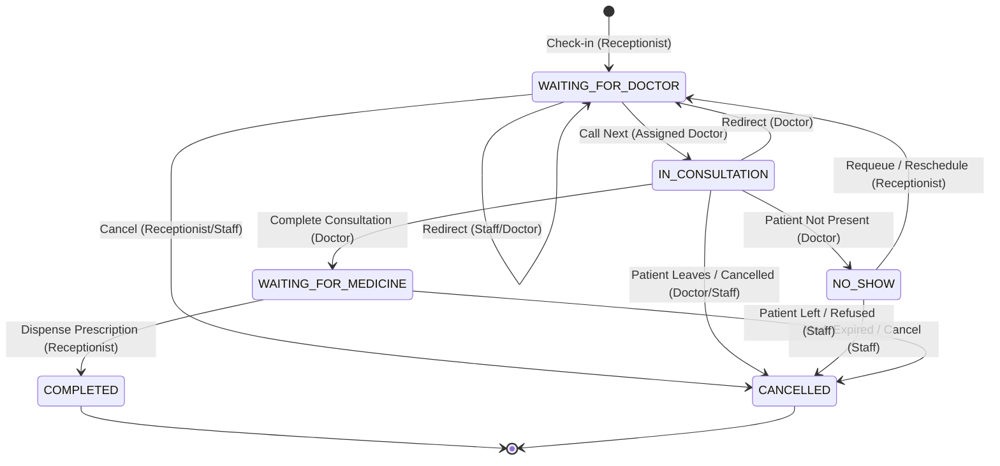

# CampusCare Queue Lifecycle & State Transitions

This document defines the lifecycle, state machine, and concurrency rules for patient visits, doctor queues, and audit events in CampusCare.

---

## 1. Architecture Overview & Core Entities

CampusCare manages OPD clinic throughput using three interconnected relational tables in MySQL without requiring secondary or redundant queue storage:

```
+-----------------------------------------------------------------------------------+
|                                  VISIT                                            |
| One record per student clinic visit session                                       |
| Key Columns: visit_id, roll_number, doctor_id, status, checked_in_at,             |
|              consultation_started_at, consultation_completed_at, completed_at,    |
|              cancelled_at, cancel_reason                                          |
+-----------------------------------------------------------------------------------+
                                          | 1
                                          |
                                          | has many (1..N)
                                          v
+-----------------------------------------------------------------------------------+
|                               QUEUE_ENTRY                                         |
| Tracks queue position in a specific doctor's line today                           |
| Key Columns: queue_entry_id, visit_id, doctor_id, queue_sequence, status,         |
|              entered_at, queue_data, called_at, exited_at,                        |
|              entry_reason, exit_reason                                            |
+-----------------------------------------------------------------------------------+
                                          | 1
                                          |
                                          | has many (1..N)
                                          v
+-----------------------------------------------------------------------------------+
|                               VISIT_EVENT                                         |
| Append-only immutable audit trail of every transition with performer ID           |
| Key Columns: event_id, visit_id, event_type, performed_by_user_id,                |
|              created_at, notes                                                    |
+-----------------------------------------------------------------------------------+
```

### Entity Scope & Responsibilities
- **`VISIT`**: Represents the overarching patient episode from the moment they arrive at the front desk until discharge or departure.
- **`QUEUE_ENTRY`**: Represents a physical stint in a doctor's waiting line. If a patient is redirected from Doctor A to Doctor B, or requeued after a temporary no-show, their original `QUEUE_ENTRY` is marked exited (`REDIRECTED` or `NO_SHOW`), and a *new* `QUEUE_ENTRY` is created under the same `visit_id`.
- **`VISIT_EVENT`**: An immutable audit log recording the exact timestamp, event type, notes, and server-validated `performed_by_user_id` for every state transition.

---

## 2. Doctor Assignment & Safe Queue Sequence Allocation

### Step 1: Doctor Eligibility Verification
1. Verify the selected doctor exists in `DOCTOR` and has an `ACTIVE` staff account in `STAFF` and `USER_ACCOUNT`.
2. Check `DOCTOR_AVAILABILITY` for `CURDATE()`. If an explicit `UNAVAILABLE` record exists, check-in is rejected with `409 Conflict`.

### Step 2: Concurrency-Safe Sequence Allocation & Numbering Definition

#### Numbering Guarantee: Unique, Monotonically Increasing per Doctor per Queue Date
- **Definition**: Within each doctor's queue for a given calendar date (`CURDATE()`), queue sequence numbers are strictly unique and monotonically increasing integers (`1, 2, 3, ...`).
- **Gaps Policy**: Gaps in the sequence of actively waiting patients are **explicitly expected and normal**:
  1. **Cancellations**: If patient #2 cancels after checking in, patient #3 remains #3. Re-numbering subsequent patients would invalidate physical token slips or mobile notifications already issued to waiting students.
  2. **Redirects & Referrals**: If patient #4 is redirected to another doctor, their queue entry in the original line is retired (`REDIRECTED`), leaving sequence #4 permanently archived.
  3. **No-Shows & Requeues**: A requeued student is appended to the tail of the queue with a *new*, higher sequence number (`MAX(queue_sequence) + 1`), rather than reclaiming their old slot.
  4. **Failed / Rolled Back Transactions**: Because the sequence is computed inside an exclusive transaction, rolled-back transactions do not commit their sequence. Any subsequent successful check-in re-reads the committed `MAX(queue_sequence) + 1`.

#### Concurrency Lock Architecture:
To eliminate race conditions between concurrent front-desk check-in terminals:
1. The transaction acquires an exclusive row lock on the doctor's record:
   ```sql
   SELECT doctor_id FROM DOCTOR WHERE doctor_id = %s FOR UPDATE;
   ```
2. While holding the exclusive doctor lock, the transaction safely computes the next sequence:
   ```sql
   SELECT COALESCE(MAX(queue_sequence), 0) + 1 AS next_seq
   FROM QUEUE_ENTRY
   WHERE doctor_id = %s AND DATE(entered_at) = CURDATE();
   ```
3. The new `QUEUE_ENTRY` is inserted using `next_seq`.
4. When the transaction commits, the lock is released. Any concurrent check-in for the same doctor waits on the lock and will reliably read the newly committed sequence number, guaranteeing zero duplicate collisions.

---

## 3. Relationship: `VISIT.status` vs `QUEUE_ENTRY.status`

The table below defines the strict synchronisation between `VISIT.status` and the corresponding active `QUEUE_ENTRY.status`:

| Clinic Stage | `VISIT.status` | Active `QUEUE_ENTRY.status` | `QUEUE_ENTRY.entry_reason` | `QUEUE_ENTRY.exit_reason` | `VISIT_EVENT.event_type` |
|---|---|---|---|---|---|
| **Initial Check-in** | `WAITING_FOR_DOCTOR` | `WAITING` | `INITIAL_CHECKIN` | `NULL` | `CHECKED_IN` |
| **Doctor Calls Patient** | `IN_CONSULTATION` | `IN_CONSULTATION` | Existing | `NULL` (called_at set) | `CONSULTATION_STARTED` |
| **Patient No-Show** | `NO_SHOW` | `NO_SHOW` | Existing | `NO_SHOW` (exited_at set) | `NO_SHOW` |
| **Requeue from No-Show** | `WAITING_FOR_DOCTOR` | `WAITING` (new row) | `NO_SHOW_RESCHEDULE` | `NULL` | `QUEUED_JOINED_PATIENT` |
| **Redirect to Doctor** | `WAITING_FOR_DOCTOR` | `WAITING` (new row, target doc) | `DOCTOR_REDIRECT` | Old row: `REDIRECTED` | `REDIRECTED` |
| **Consultation Finished** | `WAITING_FOR_MEDICINE` | `COMPLETED` | Existing | `COMPLETED` (exited_at set) | `CONSULTATION_COMPLETED` |
| **Medicine Dispensed** | `COMPLETED` | `COMPLETED` (unchanged) | Existing | Existing | `MEDICINE_DISPENSED` / `COMPLETED` |
| **Visit Cancelled** | `CANCELLED` | `CANCELLED` | Existing | `CANCELLED` (exited_at set) | `CANCELLED` |

---

## 4. State Machine & Valid Transitions



### Transition Enforcement Rules

| Action | Allowed Origin States | Target State | Authorized Roles | Side Effects |
|---|---|---|---|---|
| **Check-in** | *None (new visit)* | `WAITING_FOR_DOCTOR` | `RECEPTIONIST` | Creates `VISIT`, creates `QUEUE_ENTRY` (`WAITING`), logs `CHECKED_IN`. |
| **Call Next** | `WAITING_FOR_DOCTOR` | `IN_CONSULTATION` | `DOCTOR` (matching `doctor_id`) | Sets `consultation_started_at = NOW()`, sets `called_at = NOW()`, logs `CONSULTATION_STARTED`. |
| **Start Consultation** | `WAITING_FOR_DOCTOR` | `IN_CONSULTATION` | `DOCTOR` (matching `doctor_id`) | Sets `consultation_started_at = NOW()`, sets `called_at = NOW()`, logs `CONSULTATION_STARTED`. Enforces 1 active consultation per doctor workstation. |
| **No-Show** | `IN_CONSULTATION`, `WAITING_FOR_DOCTOR` | `NO_SHOW` | `DOCTOR` (matching `doctor_id`), `RECEPTIONIST` | Sets `QUEUE_ENTRY.exit_reason = 'NO_SHOW'`, sets `exited_at = NOW()`, logs `NO_SHOW`. Idempotent if already `NO_SHOW`. |
| **Requeue** | `NO_SHOW` | `WAITING_FOR_DOCTOR` | `RECEPTIONIST` | Creates new `QUEUE_ENTRY` (`WAITING`, `NO_SHOW_RESCHEDULE`), allocates sequence, logs `QUEUED_JOINED_PATIENT`. Verifies target doctor availability and ensures no active visit conflict exists. |
| **Redirect** | `WAITING_FOR_DOCTOR`, `IN_CONSULTATION` | `WAITING_FOR_DOCTOR` | `DOCTOR` (assigned), `RECEPTIONIST` | Exits old `QUEUE_ENTRY` (`REDIRECTED`), updates `VISIT.doctor_id`, creates new `QUEUE_ENTRY` under target doctor with reason `DOCTOR_REDIRECT`, logs `REDIRECTED`. |
| **Complete Consultation** | `IN_CONSULTATION` | `WAITING_FOR_MEDICINE` | `DOCTOR` (matching `doctor_id`) | Inserts `CONSULTATION`, `PRESCRIPTION`, `PRESCRIPTION_ITEM`, `PRESCRIPTION_DOSE`, exits `QUEUE_ENTRY` (`COMPLETED`), sets `consultation_completed_at = NOW()`, logs `CONSULTATION_COMPLETED`. |
| **Dispense** | `WAITING_FOR_MEDICINE` | `COMPLETED` | `RECEPTIONIST` | Sets `completed_at = NOW()`, logs `MEDICINE_DISPENSED` and `COMPLETED`. Idempotent if already `COMPLETED`. |
| **Cancel** | `CHECKED_IN`, `WAITING_FOR_DOCTOR`, `IN_CONSULTATION`, `WAITING_FOR_MEDICINE`, `NO_SHOW` | `CANCELLED` | `RECEPTIONIST`, `DOCTOR` | Sets `cancelled_at = NOW()`, records `cancel_reason`, exits active `QUEUE_ENTRY` (`CANCELLED`), logs dedicated `CANCELLED` audit event. Blocked on `COMPLETED` visits (409). |

---

## 5. Prevention of Conflicting Active Check-Ins & NO_SHOW Policy

### Single Active Visit Rule
A student is strictly prohibited from having more than one active clinic visit concurrently.

**Active Visit States**:
- `CHECKED_IN`
- `WAITING_FOR_DOCTOR`
- `CALLED`
- `IN_CONSULTATION`
- `WAITING_FOR_MEDICINE`

**Terminal / Non-Conflicting States**:
- `COMPLETED`
- `CANCELLED`
- `NO_SHOW`

### Settled NO_SHOW Policy
1. **New Check-Ins**: An unresolved `NO_SHOW` visit is terminal/inactive and **does not block** a subsequent check-in. If a student who was marked `NO_SHOW` in the morning returns in the afternoon and checks in, a new visit and queue entry are successfully created.
2. **Requeue Protection**: If a receptionist attempts to `requeue` an old `NO_SHOW` visit while the student already has an active visit in progress (`CHECKED_IN`, `WAITING_FOR_DOCTOR`, `IN_CONSULTATION`, `WAITING_FOR_MEDICINE`), the requeue mutation is **strictly rejected with `HTTP 409 Conflict`**. Requeueing is only permitted when the student has no other active visit.

### Concurrency Protection Mechanism
When check-in or requeue is initiated:
1. Lock student row in MySQL:
   ```sql
   SELECT roll_number FROM STUDENT WHERE roll_number = %s FOR UPDATE;
   ```
2. Query for existing visits matching active states:
   ```sql
   SELECT visit_id, status FROM VISIT
   WHERE roll_number = %s AND status IN ('CHECKED_IN', 'WAITING_FOR_DOCTOR', 'CALLED', 'IN_CONSULTATION', 'WAITING_FOR_MEDICINE')
   ORDER BY checked_in_at DESC LIMIT 1;
   ```
3. If an active visit exists, rollback and raise `HTTP 409 Conflict: Student is already in the queue`.
4. Because the `STUDENT` row is locked, simultaneous double-clicks or parallel RFID taps serialize safely: the first transaction commits the check-in; the second transaction will observe the newly active visit and immediately reject with `409 Conflict`.

---

## 6. Audit Trail & Identity Integrity

Every transition requires:
1. `performed_by_user_id`: Strictly extracted from the authenticated JWT token claim (`sub`). It can never be passed or spoofed via the HTTP request body.
2. `notes`: Concise audit description including the actor email, action reason, or doctor instructions.
3. Timestamp: Captured at transaction commit time via MySQL `NOW()`.
4. Dedicated `event_type`: Every lifecycle milestone maps to a distinct `VISIT_EVENT.event_type` ENUM value:
   `('CHECKED_IN', 'QUEUED_JOINED_PATIENT', 'CALLED', 'NO_SHOW', 'REDIRECTED', 'PRESCRIPTION_CREATED', 'CONSULTATION_STARTED', 'CONSULTATION_COMPLETED', 'WAITING_FOR_MEDICINE', 'MEDICINE_DISPENSED', 'MEDICINE_NOT_COLLECTED', 'COMPLETED', 'CANCELLED')`.

---

## 7. API Endpoint Directory & Authorization Boundaries

The API strictly delineates privileges between Receptionists, Doctors, and shared Staff roles. No user can act outside their validated token claims:

| Endpoint | Method | Status | Authorized Role | Guard / Dependency | Identity Source | Purpose |
|---|---|---|---|---|---|---|
| `/api/reception/check-ins` | `POST` | **Canonical** | `RECEPTIONIST` | `get_current_receptionist` | Token `sub` | Primary check-in route. Creates `VISIT`, allocates sequence under doctor lock, logs audit. |
| `/api/reception/checkin` | `POST` | *Alias* | `RECEPTIONIST` | `get_current_receptionist` | Token `sub` | Backwards-compatible alias for `/check-ins`. |
| `/api/queue/checkin` | `POST` | *Deprecated Alias* | `RECEPTIONIST` | `get_current_receptionist` | Token `sub` | Legacy check-in route maintained for backwards compatibility. |
| `/api/reception/queue` | `GET` | **Canonical** | `RECEPTIONIST` | `get_current_receptionist` | Token `sub` | Multi-doctor queue view showing active patients across doctors. Optional `?doctor_id=...` filter. |
| `/api/doctor/{doctor_id}/queue` | `GET` | **Canonical** | `DOCTOR`, `RECEPTIONIST` | `get_current_staff` | Token `sub`, `doctor_id` | Reads doctor's queue line (`IN_CONSULTATION` first, then `WAITING`). Doctors isolated to own queue (403); Receptionist view any doctor. |
| `/api/doctor/{doctor_id}/active-consultation` | `GET` | **Canonical** | `DOCTOR` | `get_current_doctor` + `require_own_doctor_id` | Token `doctor_id` | Returns active consultation session or `{ "active": false }`. |
| `/api/doctor/{doctor_id}/stats` | `GET` | **Canonical** | `DOCTOR` | `get_current_doctor` + `require_own_doctor_id` | Token `doctor_id` | Returns waiting count, seen today count, total today. |
| `/api/doctor/{doctor_id}/call-next` | `POST` | **Canonical** | `DOCTOR` | `get_current_doctor` + `require_own_doctor_id` | Token `doctor_id`, `sub` | Advances next waiting patient to `IN_CONSULTATION`. Serialized via doctor workstation lock; idempotent if consultation already active. |
| `/api/doctor/{doctor_id}/start-consultation` | `POST` | **Canonical** | `DOCTOR` | `get_current_doctor` + `require_own_doctor_id` | Token `doctor_id`, `sub` | Explicitly starts consultation for specific `visit_id` (or next if omitted). Enforces mutual exclusion per workstation. |
| `/api/doctor/{doctor_id}/start-consultation/{visit_id}` | `POST` | *Path Alias* | `DOCTOR` | `get_current_doctor` + `require_own_doctor_id` | Token `doctor_id`, `sub` | Convenience path-parameter route for starting consultation. |
| `/api/queue/{visit_id}/start-consultation` | `POST` | *Alias* | `DOCTOR` | `get_current_doctor` | Token `doctor_id`, `sub` | Doctor endpoint to explicitly start consultation on visit assigned to caller. |
| `/api/doctor/{doctor_id}/complete` | `POST` | **Canonical** | `DOCTOR` | `get_current_doctor` + `require_own_doctor_id` | Token `doctor_id`, `sub` | Finalizes diagnosis and prescriptions; moves visit to `WAITING_FOR_MEDICINE` and queue entry to `COMPLETED`. |
| `/api/doctor/{doctor_id}/no-show/{visit_id}` | `POST` | **Canonical** | `DOCTOR` | `get_current_doctor` + `require_own_doctor_id` | Token `doctor_id`, `sub` | Marks active visit as `NO_SHOW`. Validates visit is assigned to this doctor. Idempotent. |
| `/api/queue/{visit_id}/no-show` | `POST` | *Staff Route* | `STAFF` (Doctor/Receptionist) | `get_current_staff` | Token `sub` | Marks active visit as `NO_SHOW`. Validates doctor assignment if caller is doctor. |
| `/api/queue/{visit_id}/requeue` | `POST` | **Canonical** | `RECEPTIONIST` | `get_current_receptionist` | Token `sub` | Requeues a `NO_SHOW` visit with reason `NO_SHOW_RESCHEDULE`. Validates target doctor availability and active visit conflict. |
| `/api/queue/{visit_id}/redirect` | `POST` | **Canonical** | `STAFF` (Doctor/Receptionist) | `get_current_staff` | Token `sub` | Triage / doctor referral. Retires old queue entry as `REDIRECTED`, assigns new doctor. Validates availability. |
| `/api/doctor/{doctor_id}/redirect/{visit_id}` | `POST` | *Doctor Route* | `DOCTOR` | `get_current_doctor` + `require_own_doctor_id` | Token `doctor_id`, `sub` | Redirects patient assigned to this doctor to another doctor. |
| `/api/queue/{visit_id}/dispense` | `POST` | **Canonical** | `RECEPTIONIST` | `get_current_receptionist` | Token `sub` | Confirms pharmacy dispensing, moves visit to `COMPLETED`. Idempotent if already completed. |
| `/api/queue/{visit_id}/cancel` | `POST` | **Canonical** | `STAFF` (Doctor/Receptionist) | `get_current_staff` | Token `sub` | Cancels active visit with reason. Blocked on completed visits (409). Logs dedicated `CANCELLED` audit event. |
| `/api/queue/live` | `GET` | **Canonical** | `STAFF` (Doctor/Receptionist) | `get_current_staff` | Token `sub` | Live clinic-wide OPD monitor across all active doctors. Students blocked (403). |

---

## 8. Consultation-Start Behavior Specification

### Call Next vs Explicit Start Consultation
1. **`POST /api/doctor/{doctor_id}/call-next`**:
   - Automatically selects the next eligible patient ordered by `queue_sequence ASC, entered_at ASC LIMIT 1`.
   - Transitions `QUEUE_ENTRY` and `VISIT` to `IN_CONSULTATION`.
   - **Idempotency**: If the doctor already has an active consultation in progress, it safely returns the existing consultation session without mutating records or skipping queued patients.
2. **`POST /api/doctor/{doctor_id}/start-consultation`** (Body: `{"visit_id": 123}`):
   - Targets a specific visit assigned to this doctor.
   - **Workstation Mutual Exclusion**: If the doctor currently has an active consultation with a *different* visit, the request is immediately rejected with `HTTP 409 Conflict` (`"Doctor #X already has an active consultation with visit #Y"`).
   - If called repeatedly on the *same* visit, it is idempotent and returns `{"status": "already_in_consultation", ...}`.
3. **Concurrency Serialization**:
   - Both endpoints acquire `SELECT doctor_id FROM DOCTOR WHERE doctor_id = %s FOR UPDATE` inside the database transaction before inspecting queue state.
   - Parallel clicks or rapid double-taps serialize on the workstation lock, guaranteeing that under no circumstances can two active consultations exist for the same doctor.

---

## 9. Published Request and Response Schemas

### 1. Check-In
- **Route**: `POST /api/reception/check-ins` (Alias: `POST /api/reception/checkin`)
- **Auth**: Receptionist Token (`Authorization: Bearer <token>`)
- **Request Body**:
  ```json
  {
    "roll_number": "CS21B045",       // string, required (or "rollNumber")
    "doctor_id": 1,                   // integer, required (or "doctorId")
    "complaint": "Persistent cough",  // string, optional (max 300 chars)
    "via": "MANUAL"                   // string, optional ("MANUAL" | "RFID", default: "MANUAL")
  }
  ```
- **Success Response (201 Created)**:
  ```json
  {
    "visit_id": 105,
    "visitId": 105,
    "queue_number": 3,
    "queueNo": 3,
    "sequence": 3,
    "doctor_id": 1,
    "doctorId": 1,
    "status": "WAITING_FOR_DOCTOR",
    "position": 2,
    "name": "Aarav Mehta",
    "roll_number": "CS21B045",
    "rollNumber": "CS21B045",
    "queue_entry_id": 105,
    "queueEntryId": 105
  }
  ```
- **Error Responses**:
  - `401 Unauthorized`: Missing or invalid Bearer token.
  - `403 Forbidden`: Authenticated user is not a receptionist.
  - `404 Not Found`: Student or Doctor does not exist.
  - `409 Conflict`: Student already has an active visit, or doctor is marked UNAVAILABLE today.
  - `422 Unprocessable Entity`: Missing required `roll_number` or `doctor_id`.

### 2. Reception Queue View
- **Route**: `GET /api/reception/queue?doctor_id=1` (`doctor_id` query param optional)
- **Auth**: Receptionist Token
- **Success Response (200 OK)**:
  ```json
  [
    {
      "queueEntryId": 105,
      "queue_entry_id": 105,
      "visitId": 105,
      "visit_id": 105,
      "rollNumber": "CS21B045",
      "roll_number": "CS21B045",
      "name": "Aarav Mehta",
      "student_name": "Aarav Mehta",
      "bloodGroup": "O+",
      "blood_group": "O+",
      "doctorId": 1,
      "doctor_id": 1,
      "doctorName": "Dr Neha Kapoor",
      "doctor_name": "Dr Neha Kapoor",
      "doctorEmail": "neha.kapoor@campuscare.edu",
      "doctor_email": "neha.kapoor@campuscare.edu",
      "specialty": "General Physician",
      "room": "Room 104",
      "queueNo": 3,
      "queue_number": 3,
      "queue_sequence": 3,
      "status": "Waiting",
      "statusCode": "WAITING",
      "queueStatus": "WAITING",
      "visitStatus": "WAITING_FOR_DOCTOR",
      "checkInTime": "2026-10-18T10:15:00",
      "checkedInAt": "2026-10-18T10:15:00",
      "enteredAt": "2026-10-18T10:15:00",
      "waitingSince": "10:15 AM",
      "calledAt": null,
      "complaint": "Persistent cough"
    }
  ]
  ```

### 3. Doctor Call Next
- **Route**: `POST /api/doctor/{doctor_id}/call-next`
- **Auth**: Doctor Token (matching `doctor_id`)
- **Request Body**: None
- **Success Response (200 OK)**:
  ```json
  {
    "status": "called",              // or "already_in_consultation"
    "queueEntryId": 105,
    "queue_entry_id": 105,
    "visitId": 105,
    "visit_id": 105,
    "rollNumber": "CS21B045",
    "roll_number": "CS21B045",
    "name": "Aarav Mehta",
    "sequence": 3,
    "queueNo": 3,
    "queue_number": 3,
    "doctorId": 1,
    "doctor_id": 1
  }
  ```
- **Error Responses**:
  - `403 Forbidden`: Doctor authenticated as a different doctor ID.
  - `404 Not Found`: No patients currently waiting in queue.

### 4. Doctor Start Consultation
- **Route**: `POST /api/doctor/{doctor_id}/start-consultation`
- **Auth**: Doctor Token (matching `doctor_id`)
- **Request Body**:
  ```json
  {
    "visit_id": 105                  // integer, optional (omitted = advance next waiting)
  }
  ```
- **Success Response (200 OK)**:
  ```json
  {
    "status": "in_consultation",     // or "already_in_consultation"
    "queueEntryId": 105,
    "visitId": 105,
    "rollNumber": "CS21B045",
    "name": "Aarav Mehta",
    "sequence": 3,
    "queueNo": 3,
    "doctorId": 1
  }
  ```
- **Error Responses**:
  - `409 Conflict`: Doctor already has an active consultation with another visit, or target visit is in an invalid status.

### 5. Complete Consultation
- **Route**: `POST /api/doctor/{doctor_id}/complete`
- **Auth**: Doctor Token (matching `doctor_id`)
- **Request Body**:
  ```json
  {
    "roll_number": "CS21B045",       // string, required
    "diagnosis": "Acute Bronchitis", // string, required
    "general": "Rest and steam",     // string, optional
    "medicines": [                    // array, required
      {
        "name": "Amoxicillin 500mg", // string, required
        "note": "After meals",       // string, optional
        "morning": true,              // boolean, optional
        "afternoon": false,          // boolean, optional
        "evening": true,             // boolean, optional
        "night": false               // boolean, optional
      }
    ]
  }
  ```
- **Success Response (200 OK)**:
  ```json
  {
    "status": "ok",
    "visitId": 105,
    "consultationId": 42,
    "prescriptionId": 38
  }
  ```

### 6. Dispense Medication
- **Route**: `POST /api/queue/{visit_id}/dispense`
- **Auth**: Receptionist Token
- **Request Body**:
  ```json
  {
    "remarks": "Medicines dispensed" // string, optional
  }
  ```
- **Success Response (200 OK)**:
  ```json
  {
    "status": "dispensed",           // or "already_completed"
    "visitId": 105,
    "rollNumber": "CS21B045"
  }
  ```
- **Error Responses**:
  - `409 Conflict`: Visit is not in `WAITING_FOR_MEDICINE` status.

### 7. Mark No-Show
- **Route**: `POST /api/doctor/{doctor_id}/no-show/{visit_id}` (or `POST /api/queue/{visit_id}/no-show`)
- **Auth**: Doctor Token (matching `doctor_id`) or Staff Token
- **Request Body**:
  ```json
  {
    "reason": "Student absent"       // string, optional
  }
  ```
- **Success Response (200 OK)**:
  ```json
  {
    "status": "no_show",             // or "already_no_show"
    "visitId": 105,
    "rollNumber": "CS21B045",
    "doctorId": 1
  }
  ```
- **Error Responses**:
  - `409 Conflict`: Visit is in `COMPLETED`, `CANCELLED`, or `WAITING_FOR_MEDICINE`.

### 8. Requeue Patient
- **Route**: `POST /api/queue/{visit_id}/requeue`
- **Auth**: Receptionist Token
- **Request Body**:
  ```json
  {
    "target_doctor_id": 1,           // integer, required
    "reason": "Patient arrived"      // string, optional
  }
  ```
- **Success Response (200 OK)**:
  ```json
  {
    "status": "requeued",
    "visitId": 105,
    "queueEntryId": 112,
    "queueNo": 5,
    "doctorId": 1,
    "rollNumber": "CS21B045"
  }
  ```
- **Error Responses**:
  - `409 Conflict`: Visit is not in `NO_SHOW`, or target doctor is unavailable, or student has another active visit in progress.

### 9. Redirect Patient
- **Route**: `POST /api/queue/{visit_id}/redirect` (or `POST /api/doctor/{doctor_id}/redirect/{visit_id}`)
- **Auth**: Staff Token (Doctor/Receptionist)
- **Request Body**:
  ```json
  {
    "target_doctor_id": 2,           // integer, required
    "reason": "Specialist referral"  // string, optional
  }
  ```
- **Success Response (200 OK)**:
  ```json
  {
    "status": "redirected",
    "visitId": 105,
    "oldDoctorId": 1,
    "newDoctorId": 2,
    "newQueueNo": 4,
    "queueEntryId": 113,
    "rollNumber": "CS21B045"
  }
  ```

### 10. Cancel Visit
- **Route**: `POST /api/queue/{visit_id}/cancel`
- **Auth**: Staff Token (Doctor/Receptionist)
- **Request Body**:
  ```json
  {
    "reason": "Emergency departure"  // string, optional
  }
  ```
- **Success Response (200 OK)**:
  ```json
  {
    "status": "cancelled",           // or "already_cancelled"
    "visitId": 105,
    "rollNumber": "CS21B045"
  }
  ```
- **Error Responses**:
  - `409 Conflict`: Cannot cancel an already `COMPLETED` visit.

---

## 10. Database & Queue Edge-Case Architecture (Priority 2 Guarantees)

### 1. Unified Queue Numbering Across All Entry Paths
- **Entry Paths**: Patient queues can be entered through three operations:
  1. Initial check-in (`check_in_student`)
  2. Requeue from no-show (`requeue_patient`)
  3. Referral or transfer redirect (`redirect_patient`)
- **Concurrency & Locking Contract**:
  All three paths execute within an explicit database transaction and acquire an exclusive row lock on the target doctor:
  ```sql
  SELECT doctor_id FROM DOCTOR WHERE doctor_id = %s FOR UPDATE;
  ```
  While holding this lock, the next sequence is allocated:
  ```sql
  SELECT COALESCE(MAX(queue_sequence), 0) + 1 AS next_seq
  FROM QUEUE_ENTRY
  WHERE doctor_id = %s AND DATE(entered_at) = CURDATE();
  ```
- **Monotonic & Gap Invariants**: Sequence numbers are strictly unique and monotonically increasing per doctor per date. Gaps resulting from cancellations, redirects, or rollbacks are natural and preserved to avoid invalidating physical tokens.

### 2. Safe Redirect During Consultation
- **Session Retirement**: When a doctor redirects a student currently in consultation:
  1. The active `QUEUE_ENTRY` is retired with `status = 'REDIRECTED'`, `exited_at = NOW()`, and `exit_reason = 'REDIRECTED'`.
  2. The referring doctor's active workstation is freed (`active = False`), enabling the doctor to immediately call their next waiting patient.
  3. The `VISIT.doctor_id` is updated to the target doctor.
  4. A new `QUEUE_ENTRY` is created in the target doctor's queue with `status = 'WAITING'`, `entry_reason = 'DOCTOR_REDIRECT'`, and the target doctor's next sequence number.
  5. An atomic audit event `REDIRECTED` is written to `VISIT_EVENT` noting the source doctor and destination doctor.

### 3. Concurrency-Safe Doctor Availability Validation
- **Validation Point**: Check-in, requeue, and redirect all strictly validate target doctor availability on `CURDATE()`.
- **Race Condition Protection**: The availability lookup acquires a row lock:
  ```sql
  SELECT is_available FROM DOCTOR_AVAILABILITY 
  WHERE doctor_id = %s AND date = CURDATE() FOR UPDATE;
  ```
  If an availability toggle is happening concurrently, the queue mutation waits for the lock, guaranteeing that patients are never placed into an unavailable doctor's queue.

### 4. Strict Transaction Rollback & Zero Partial Updates
- Every state-changing operation executes inside a managed transaction context.
- If any step fails (e.g. invalid status transition, database foreign key violation, unexpected exception), the entire transaction rolls back via `conn.rollback()`.
- No partial mutations are committed to `VISIT`, `QUEUE_ENTRY`, `CONSULTATION`, `PRESCRIPTION`, or `VISIT_EVENT`.

### 5. Complete Idempotency Guarantees
- **Call-Next Idempotency**: If a doctor retries `call-next` while they already have an active consultation (`IN_CONSULTATION`), the endpoint does not advance or skip any waiting students. It safely returns the existing active consultation session.
- **Dispense Idempotency**: If pharmacy retries dispensing an already completed visit (`COMPLETED`), the endpoint returns `status = 'already_completed'` and does not append duplicate `MEDICINE_DISPENSED` audit records.
- **Cancel & No-Show Idempotency**: Repeated cancellation or no-show requests return `already_cancelled` / `already_no_show` safely without state corruption.

### 6. Token-Derived Audit Consistency
- Every state change records exactly one `VISIT_EVENT` row.
- Performer identity (`performed_by_user_id`) is strictly extracted from the cryptographically verified JWT token (`current_user["id"]` / `sub`), never from client body fields or query parameters.

### 7. Uniform Active Visit Constraints
- **Active Statuses**: `CHECKED_IN`, `WAITING_FOR_DOCTOR`, `CALLED`, `IN_CONSULTATION`, `WAITING_FOR_MEDICINE`. A student with any of these statuses cannot be checked in again (enforced with `409 Conflict`).
- **Terminal Statuses**: `COMPLETED`, `CANCELLED`, `NO_SHOW`. A student whose previous visit is terminal is eligible for a new check-in.
- **Requeue Conflict Guard**: A `NO_SHOW` visit cannot be requeued if the student has subsequently begun a new active visit.


