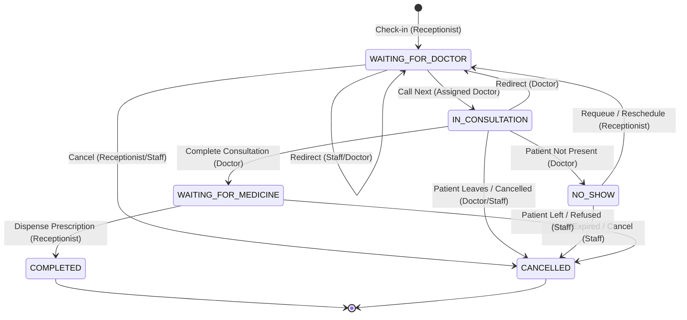

# CampusCare Queue Lifecycle & State Transitions

This document defines the lifecycle, state machine, and concurrency rules for patient visits, doctor queues, and audit events in CampusCare.

---

## 1. Architecture Overview & Core Entities

CampusCare manages OPD clinic throughput using three interconnected relational tables in MySQL without requiring secondary or redundant queue storage:

```
+-----------------------------------------------------------------------------------+
|                                  VISIT                                            |
| One record per student clinic visit session                                       |
| Key Columns: visit_id, roll_number, doctor_id, status, checked_in_at,             |
|              consultation_started_at, consultation_completed_at, completed_at,    |
|              cancelled_at, cancel_reason                                          |
+-----------------------------------------------------------------------------------+
                                          | 1
                                          |
                                          | has many (1..N)
                                          v
+-----------------------------------------------------------------------------------+
|                               QUEUE_ENTRY                                         |
| Tracks queue position in a specific doctor's line today                           |
| Key Columns: queue_entry_id, visit_id, doctor_id, queue_sequence, status,         |
|              entered_at, queue_data, called_at, exited_at,                        |
|              entry_reason, exit_reason                                            |
+-----------------------------------------------------------------------------------+
                                          | 1
                                          |
                                          | has many (1..N)
                                          v
+-----------------------------------------------------------------------------------+
|                               VISIT_EVENT                                         |
| Append-only immutable audit trail of every transition with performer ID           |
| Key Columns: event_id, visit_id, event_type, performed_by_user_id,                |
|              created_at, notes                                                    |
+-----------------------------------------------------------------------------------+
```

### Entity Scope & Responsibilities
- **`VISIT`**: Represents the overarching patient episode from the moment they arrive at the front desk until discharge or departure.
- **`QUEUE_ENTRY`**: Represents a physical stint in a doctor's waiting line. If a patient is redirected from Doctor A to Doctor B, or requeued after a temporary no-show, their original `QUEUE_ENTRY` is marked exited (`REDIRECTED` or `NO_SHOW`), and a *new* `QUEUE_ENTRY` is created under the same `visit_id`.
- **`VISIT_EVENT`**: An immutable audit log recording the exact timestamp, event type, notes, and server-validated `performed_by_user_id` for every state transition.

---

## 2. Doctor Assignment & Safe Queue Sequence Allocation

### Step 1: Doctor Eligibility Verification
1. Verify the selected doctor exists in `DOCTOR` and has an `ACTIVE` staff account in `STAFF` and `USER_ACCOUNT`.
2. Check `DOCTOR_AVAILABILITY` for `CURDATE()`. If an explicit `UNAVAILABLE` record exists, check-in is rejected with `409 Conflict`.

### Step 2: Concurrency-Safe Sequence Allocation & Numbering Definition

#### Numbering Guarantee: Unique, Monotonically Increasing per Doctor per Queue Date
- **Definition**: Within each doctor's queue for a given calendar date (`CURDATE()`), queue sequence numbers are strictly unique and monotonically increasing integers (`1, 2, 3, ...`).
- **Gaps Policy**: Gaps in the sequence of actively waiting patients are **explicitly expected and normal**:
  1. **Cancellations**: If patient #2 cancels after checking in, patient #3 remains #3. Re-numbering subsequent patients would invalidate physical token slips or mobile notifications already issued to waiting students.
  2. **Redirects & Referrals**: If patient #4 is redirected to another doctor, their queue entry in the original line is retired (`REDIRECTED`), leaving sequence #4 permanently archived.
  3. **No-Shows & Requeues**: A requeued student is appended to the tail of the queue with a *new*, higher sequence number (`MAX(queue_sequence) + 1`), rather than reclaiming their old slot.
  4. **Failed / Rolled Back Transactions**: Because the sequence is computed inside an exclusive transaction, rolled-back transactions do not commit their sequence. Any subsequent successful check-in re-reads the committed `MAX(queue_sequence) + 1`.

#### Concurrency Lock Architecture:
To eliminate race conditions between concurrent front-desk check-in terminals:
1. The transaction acquires an exclusive row lock on the doctor's record:
   ```sql
   SELECT doctor_id FROM DOCTOR WHERE doctor_id = %s FOR UPDATE;
   ```
2. While holding the exclusive doctor lock, the transaction safely computes the next sequence:
   ```sql
   SELECT COALESCE(MAX(queue_sequence), 0) + 1 AS next_seq
   FROM QUEUE_ENTRY
   WHERE doctor_id = %s AND DATE(entered_at) = CURDATE();
   ```
3. The new `QUEUE_ENTRY` is inserted using `next_seq`.
4. When the transaction commits, the lock is released. Any concurrent check-in for the same doctor waits on the lock and will reliably read the newly committed sequence number, guaranteeing zero duplicate collisions.

---

## 3. Relationship: `VISIT.status` vs `QUEUE_ENTRY.status`

The table below defines the strict synchronisation between `VISIT.status` and the corresponding active `QUEUE_ENTRY.status`:

| Clinic Stage | `VISIT.status` | Active `QUEUE_ENTRY.status` | `QUEUE_ENTRY.entry_reason` | `QUEUE_ENTRY.exit_reason` | `VISIT_EVENT.event_type` |
|---|---|---|---|---|---|
| **Initial Check-in** | `WAITING_FOR_DOCTOR` | `WAITING` | `INITIAL_CHECKIN` | `NULL` | `CHECKED_IN` |
| **Doctor Calls Patient** | `IN_CONSULTATION` | `IN_CONSULTATION` | Existing | `NULL` (called_at set) | `CONSULTATION_STARTED` |
| **Patient No-Show** | `NO_SHOW` | `NO_SHOW` | Existing | `NO_SHOW` (exited_at set) | `NO_SHOW` |
| **Requeue from No-Show** | `WAITING_FOR_DOCTOR` | `WAITING` (new row) | `NO_SHOW_RESCHEDULE` | `NULL` | `QUEUED_JOINED_PATIENT` |
| **Redirect to Doctor** | `WAITING_FOR_DOCTOR` | `WAITING` (new row, target doc) | `DOCTOR_REDIRECT` | Old row: `REDIRECTED` | `REDIRECTED` |
| **Consultation Finished** | `WAITING_FOR_MEDICINE` | `COMPLETED` | Existing | `COMPLETED` (exited_at set) | `CONSULTATION_COMPLETED` |
| **Medicine Dispensed** | `COMPLETED` | `COMPLETED` (unchanged) | Existing | Existing | `MEDICINE_DISPENSED` / `COMPLETED` |
| **Visit Cancelled** | `CANCELLED` | `CANCELLED` | Existing | `CANCELLED` (exited_at set) | `COMPLETED` (cancelled) |

---

## 4. State Machine & Valid Transitions



### Transition Enforcement Rules

| Action | Allowed Origin States | Target State | Authorized Roles | Side Effects |
|---|---|---|---|---|
| **Check-in** | *None (new visit)* | `WAITING_FOR_DOCTOR` | `RECEPTIONIST` | Creates `VISIT`, creates `QUEUE_ENTRY` (`WAITING`), logs `CHECKED_IN`. |
| **Call Next** | `WAITING_FOR_DOCTOR` | `IN_CONSULTATION` | `DOCTOR` (matching `doctor_id`) | Sets `consultation_started_at = NOW()`, sets `called_at = NOW()`, logs `CONSULTATION_STARTED`. |
| **No-Show** | `IN_CONSULTATION`, `WAITING_FOR_DOCTOR` | `NO_SHOW` | `DOCTOR` (matching `doctor_id`) | Sets `QUEUE_ENTRY.exit_reason = 'NO_SHOW'`, sets `exited_at = NOW()`, logs `NO_SHOW`. |
| **Requeue** | `NO_SHOW` | `WAITING_FOR_DOCTOR` | `RECEPTIONIST` | Creates new `QUEUE_ENTRY` (`WAITING`, `NO_SHOW_RESCHEDULE`), allocates sequence, logs `QUEUED_JOINED_PATIENT`. |
| **Redirect** | `WAITING_FOR_DOCTOR`, `IN_CONSULTATION` | `WAITING_FOR_DOCTOR` | `DOCTOR`, `RECEPTIONIST` | Exits old `QUEUE_ENTRY` (`REDIRECTED`), updates `VISIT.doctor_id`, creates new `QUEUE_ENTRY` under target doctor with reason `DOCTOR_REDIRECT`, logs `REDIRECTED`. |
| **Complete Consultation** | `IN_CONSULTATION` | `WAITING_FOR_MEDICINE` | `DOCTOR` (matching `doctor_id`) | Inserts `CONSULTATION`, `PRESCRIPTION`, `PRESCRIPTION_ITEM`, `PRESCRIPTION_DOSE`, exits `QUEUE_ENTRY` (`COMPLETED`), sets `consultation_completed_at = NOW()`, logs `CONSULTATION_COMPLETED`. |
| **Dispense** | `WAITING_FOR_MEDICINE` | `COMPLETED` | `RECEPTIONIST` | Sets `completed_at = NOW()`, logs `MEDICINE_DISPENSED` and `COMPLETED`. |
| **Cancel** | `CHECKED_IN`, `WAITING_FOR_DOCTOR`, `IN_CONSULTATION`, `WAITING_FOR_MEDICINE`, `NO_SHOW` | `CANCELLED` | `RECEPTIONIST`, `DOCTOR` | Sets `cancelled_at = NOW()`, records `cancel_reason`, exits active `QUEUE_ENTRY` (`CANCELLED`), logs event. |

---

## 5. Prevention of Conflicting Active Check-Ins

### Policy
A student is strictly prohibited from having more than one active clinic visit concurrently.

**Active Visit States**:
- `CHECKED_IN`
- `WAITING_FOR_DOCTOR`
- `CALLED`
- `IN_CONSULTATION`
- `WAITING_FOR_MEDICINE`

**Terminal / Non-Conflicting States**:
- `COMPLETED`
- `CANCELLED`
- `NO_SHOW` *(until explicitly requeued)*

### Concurrency Protection Mechanism
When check-in is initiated:
1. Lock student row in MySQL:
   ```sql
   SELECT roll_number FROM STUDENT WHERE roll_number = %s FOR UPDATE;
   ```
2. Query for existing visits matching active states:
   ```sql
   SELECT visit_id, status FROM VISIT
   WHERE roll_number = %s AND status IN ('CHECKED_IN', 'WAITING_FOR_DOCTOR', 'CALLED', 'IN_CONSULTATION', 'WAITING_FOR_MEDICINE')
   ORDER BY checked_in_at DESC LIMIT 1;
   ```
3. If an active visit exists, rollback and raise `HTTP 409 Conflict: Student is already in the queue`.
4. Because the `STUDENT` row is locked, simultaneous double-clicks or parallel RFID taps serialize safely: the first transaction commits the check-in; the second transaction will observe the newly active visit and immediately reject with `409 Conflict`.

---

## 6. Audit Trail & Identity Integrity

Every transition requires:
1. `performed_by_user_id`: Strictly extracted from the authenticated JWT token claim (`sub`). It can never be passed or spoofed via the HTTP request body.
2. `notes`: Concise audit description including the actor email, action reason, or doctor instructions.
3. Timestamp: Captured at transaction commit time via MySQL `NOW()`.

---

## 7. API Endpoint Directory & Authorization Boundaries

The API strictly delineates privileges between Receptionists, Doctors, and shared Staff roles. No user can act outside their validated token claims:

| Endpoint | Method | Authorized Role | Guard / Dependency | Identity Source | Purpose |
|---|---|---|---|---|---|
| `/api/doctor/{doctor_id}/queue` | `GET` | `DOCTOR` | `get_current_doctor` + `require_own_doctor_id` | Server Token (`doctor_id`) | Reads the doctor's queue (`IN_CONSULTATION` first, then `WAITING` by sequence). Cross-doctor access blocked (403). |
| `/api/doctor/{doctor_id}/active-consultation` | `GET` | `DOCTOR` | `get_current_doctor` + `require_own_doctor_id` | Server Token (`doctor_id`) | Dedicated endpoint returning the active consultation session (`IN_CONSULTATION`) or `active=false`. |
| `/api/doctor/{doctor_id}/stats` | `GET` | `DOCTOR` | `get_current_doctor` + `require_own_doctor_id` | Server Token (`doctor_id`) | Returns waiting count, seen today count, total today. |
| `/api/doctor/{doctor_id}/call-next` | `POST` | `DOCTOR` | `get_current_doctor` + `require_own_doctor_id` | Server Token (`doctor_id`, `sub`) | Advances next waiting patient to `IN_CONSULTATION`. Idempotent if consultation already active. |
| `/api/doctor/{doctor_id}/complete` | `POST` | `DOCTOR` | `get_current_doctor` + `require_own_doctor_id` | Server Token (`doctor_id`, `sub`) | Finalizes diagnosis and prescriptions; moves visit to `WAITING_FOR_MEDICINE` and queue entry to `COMPLETED`. |
| `/api/doctor/{doctor_id}/no-show/{visit_id}` | `POST` | `DOCTOR` | `get_current_doctor` + `require_own_doctor_id` | Server Token (`doctor_id`, `sub`) | Marks active visit as `NO_SHOW`. Validates visit is assigned to this doctor. |
| `/api/queue/checkin` | `POST` | `RECEPTIONIST` | `get_current_receptionist` | Server Token (`sub`) | Checks student into doctor's queue. Enforces single active visit policy. Retries on transient deadlock. |
| `/api/queue/{visit_id}/dispense` | `POST` | `RECEPTIONIST` | `get_current_receptionist` | Server Token (`sub`) | Confirms pharmacy dispensing, moves visit to `COMPLETED`. Idempotent if already completed. |
| `/api/queue/{visit_id}/requeue` | `POST` | `RECEPTIONIST` | `get_current_receptionist` | Server Token (`sub`) | Requeues a `NO_SHOW` visit with reason `NO_SHOW_RESCHEDULE`. |
| `/api/queue/{visit_id}/redirect` | `POST` | `STAFF` (Doctor/Receptionist) | `get_current_staff` | Server Token (`sub`) | Triage / doctor referral. Retires old queue entry as `REDIRECTED`, assigns new doctor. |
| `/api/queue/{visit_id}/cancel` | `POST` | `STAFF` (Doctor/Receptionist) | `get_current_staff` | Server Token (`sub`) | Cancels active visit with reason. Blocked on completed visits (409). |
| `/api/queue/live` | `GET` | `STAFF` (Doctor/Receptionist) | `get_current_staff` | Server Token (`sub`) | Live clinic-wide OPD monitor across all active doctors. Students blocked (403). |

---

## 8. Idempotency Guarantees & Verification Protocol

### Idempotency Behavior
1. **`call-next`**:
   - The query filters strictly by `WHERE qe.doctor_id = %s AND qe.status = 'IN_CONSULTATION' LIMIT 1`.
   - If an active consultation exists, the method returns `{"status": "already_in_consultation", ...}` immediately.
   - It **never** causes a second patient to enter consultation, and **never** returns another doctor's patient session.
2. **`dispense`**:
   - The method reads `VISIT.status`. If already `COMPLETED`, it immediately returns `{"status": "already_completed", ...}`.
   - It **does not insert** redundant `MEDICINE_DISPENSED` or `COMPLETED` audit rows into `VISIT_EVENT` on retries.
   - If the original dispense transaction failed or rolled back, the status remains `WAITING_FOR_MEDICINE`, allowing subsequent retries to commit cleanly.

### Environment & Test Isolation Rules
1. **Live Database Target**: All tests execute against Aiven MySQL 8.4.8 (`campuscare_dev`). SQLite fallbacks are strictly disabled.
2. **Test Isolation**: All test students use the reserved prefix `TEST_STU_%` and test accounts `test_stu_%@thapar.edu`.
3. **Cascading Teardown**: Setup and teardown delete test visits and cascade to `QUEUE_ENTRY`, `VISIT_EVENT`, `CONSULTATION`, `PRESCRIPTION`, and test `STUDENT`/`USER_ACCOUNT` rows without touching any real patient records.
4. **Persistent Verification**: Tests directly query the MySQL database with SQL assertions (`SELECT status FROM VISIT`, `SELECT status FROM QUEUE_ENTRY`, `SELECT event_type FROM VISIT_EVENT`), verifying persisted relational state rather than relying solely on HTTP responses.
5. **Real OS Concurrency**: Parallel requests are dispatched using Python's `ThreadPoolExecutor(max_workers=5)` to test real InnoDB row locking and race-condition resistance.

